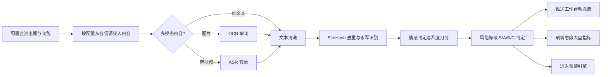
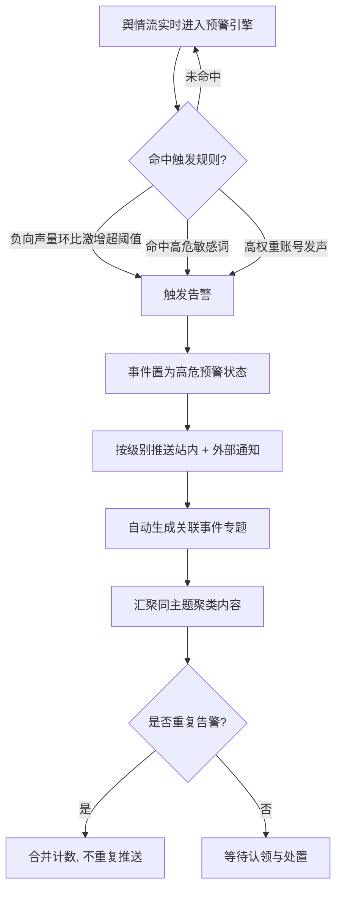
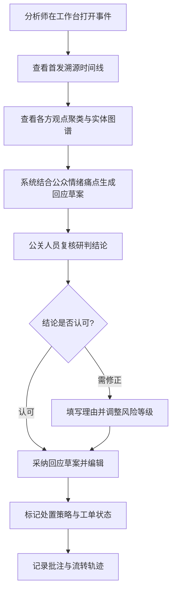
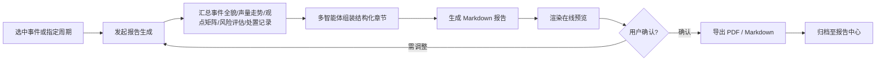
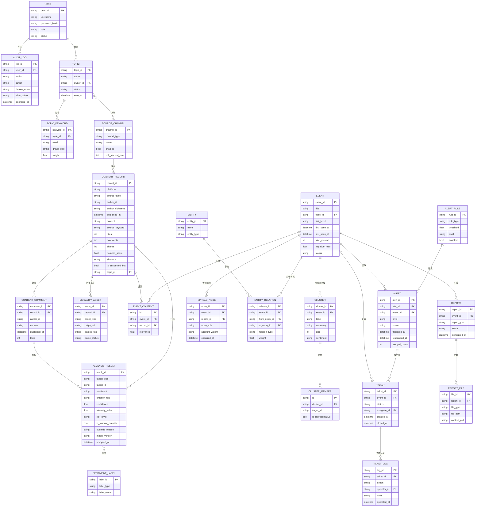

# 智能舆情分析平台 需求规格说明书（PRD）

> | 文档名称 | 智能舆情分析平台 需求规格说明书（PRD） |
> |----------|--------------------------------------|
> | 版本 | v0.2 |
> | 作者角色 | 产品经理 |
> | 日期 | 2026-10-14 |
> | 状态 | 评审稿 |
> | 变更 | v0.2：冻结准确率基线并明确评测集标注方式、将 4 类信源的模拟数据纳入交付范围，详见第 11 章「已确认事项」 |
> | 需求来源 | `docs/舆情分析平台项目实战.md`、尚硅谷「舆情分析（多智能体）」课程资料（架构参考） |
> | 交付形态 | 课程实战 / 毕设级可运行系统（前端态势大屏 + 研判工作台 + 后端分析服务 + 模拟数据集 + 端到端演示链路） |

---

## 1. 产品目标与价值

### 1.1 背景与要解决的问题

企业品牌与公共事件的舆情处置长期依赖人工：分析师需要逐平台翻找内容、凭经验判断情绪与风险、手工汇总成报告。这条链路存在三个核心痛点：

1. **看不全**：信息散落在社交媒体、新闻门户、短视频平台、行业论坛，人工巡检必然漏检，负面苗头常在爆发后才被发现。
2. **判不准**：情绪强度、传播烈度、责任归属缺乏统一口径，风险等级靠个人经验拍板，容易误判或过度反应。
3. **写不快**：一份结构化研判报告从取证到成稿往往需要数小时，错过黄金回应窗口。

### 1.2 建设目标

建设一个面向企业品牌与公共事件的智能舆情分析平台，实现「配置主题 → 自动监测 → 自动研判 → 主动预警 → 协同处置 → 一键成稿」的闭环：

- **全网多源监测**：按监测主题与关键词，从社交媒体、新闻门户、短视频平台、行业论坛等信源持续接入内容。
- **多模态解析**：对图文内容做 OCR 取词、对音视频内容做 ASR 转录，统一归一到文本证据。
- **智能认知分析**：基于大语言模型与 NLP 算法完成情感倾向与细粒度情绪识别、风险分级、热点实体抽取与关联图谱、传播脉络溯源、核心观点聚类。
- **主动预警与协同处置**：按规则实时触发分级告警，推送通知并驱动处置状态流转。
- **结构化研判报告**：自动生成包含传播态势、观点矩阵、风险结论与应对建议的研判报告，支持在线预览与多格式导出。

### 1.3 成功标准（可量化）

| 编号 | 指标 | 目标值 | 度量方式 |
|------|------|--------|---------|
| SC-01 | 信源通道覆盖 | ≥ 4 类（社交媒体 / 新闻门户 / 短视频 / 行业论坛） | 监测配置页已启用通道数 |
| SC-02 | 情感倾向识别准确率 | ≥ 85% | 在固定标注评测集（≥ 300 条，正 / 中 / 负均衡）上的三分类准确率 |
| SC-03 | 风险等级判定一致性 | 与人工标注一致率 ≥ 80% | 抽样 100 条事件，与人工标注的风险等级比对 |
| SC-04 | 高危预警时效 | S/A 级事件从内容入库到告警推送 ≤ 3 分钟 | 告警记录时间戳差值 |
| SC-05 | 单事件研判报告生成耗时 | ≤ 5 分钟（端到端，含多智能体调用） | 报告任务开始至产物落盘时间 |
| SC-06 | 重复内容识别能力 | SimHash 去重召回率 ≥ 95%（同质文本合并） | 构造重复语料回归测试 |
| SC-07 | 端到端演示可复现 | ≥ 1 个完整舆情事件（监测→预警→研判→处置→报告）全链路跑通 | 演示脚本执行记录 |
| SC-08 | 报告导出完整性 | 报告导出 PDF / Markdown 均成功且内容与在线预览一致 | 导出文件校验 |

> 注：SC-02、SC-03 的准确率基线已确认冻结。配套评测集由项目组**基于模拟多源数据自行构造并人工标注**（情感评测集 ≥ 300 条且正 / 中 / 负均衡；风险等级抽 100 条事件标注），评测集与标注结果随项目交付，并作为后续模型或 Prompt 调整的回归测试基线。

---

## 2. 用户角色与权限矩阵

| 角色 | 职责描述 | 核心权限 |
|------|---------|---------|
| 舆情分析师 | 负责日常监测巡检、事件研判、观点下钻与报告产出，是平台的主要使用者 | 创建/编辑/停用**本人**监测主题；查看全量舆情流；发起事件研判与观点聚类下钻；复核/调整事件风险等级；发起并导出研判报告；查看实体关系图谱与传播溯源时间线 |
| 公关运营人员 | 负责接收突发高危预警、制定并执行对外回应策略，是处置动作的执行者 | 查看全量舆情流与预警列表；查看事件传播脉络与核心观点；采纳/编辑大模型生成的公关回应草案；流转处置工单状态；新增处置批注；**不可**修改监测主题与预警阈值 |
| 系统管理员 | 负责平台运行配置与稳定性，不参与业务研判 | 配置信源采集通道开关与采集频率；维护预警分级阈值与通知渠道；管理用户账号与角色分配；查看系统运行日志与任务状态；**不可**修改他人主题的业务研判结论 |

**权限实现约定**：

- 权限按「角色 × 功能 × 数据范围」三级控制。数据范围分为：全量数据（管理员、公关）、主题归属数据（分析师仅可编辑本人创建的主题）。
- 处置动作（工单流转、回应草案采纳）为分析师与公关共有的写入权限，但工单的最终关闭仅公关运营人员可执行。
- 所有写入操作（主题变更、阈值变更、工单流转）须记录操作人、时间、变更前后值。

---

## 3. 用户故事

- **US-01**：作为舆情分析师，我希望用一组主题词包定义监测范围（含品牌词、竞品词、事件词、排除词），以便只接收与我关注对象相关的内容，减少噪声。
- **US-02**：作为舆情分析师，我希望在态势大盘一屏看到全网声量趋势、情感倾向分布、实时预警滚动列表与热点词云，以便快速掌握整体态势。
- **US-03**：作为舆情分析师，我希望在监测流中按主题、信源渠道、时间跨度、情感标签、风险等级多维筛选舆情卡片，以便快速定位需要研判的内容。
- **US-04**：作为舆情分析师，我希望查看单条舆情详情时能同时看到原文、图片 OCR 文本与音视频 ASR 转录文本，以便不遗漏多模态信息中的关键证据。
- **US-05**：作为舆情分析师，我希望系统自动把同一事件的讨论聚合成一个事件专题，并给出核心观点聚类，以便不必逐条阅读就能抓住争议焦点。
- **US-06**：作为舆情分析师，我希望看到选定事件的传播溯源时间线与关键传播节点（首发源、引爆点、高权重账号），以便判断事件从哪来、被谁放大。
- **US-07**：作为舆情分析师，我希望系统给出实体关系图谱（机构、人物、产品、事件及其关联），以便理解事件涉及的主体与责任链。
- **US-08**：作为舆情分析师，我希望系统自动判定事件风险等级（S/A/B/C），同时保留我人工复核与调整的入口，以便在算法误判时快速纠正。
- **US-09**：作为舆情分析师，我希望基于选定事件一键生成结构化研判报告，并在报告中心在线预览、导出 PDF 与 Markdown，以便直接用于内部汇报与归档。
- **US-10**：作为公关运营人员，我希望突发事件触发预警时收到即时通知（站内 + 至少一种外部渠道），以便第一时间介入处置。
- **US-11**：作为公关运营人员，我希望系统依据事件性质与公众诉求痛点自动生成公关回应话术草案，我可以在其基础上编辑后采纳，以便缩短回应成稿时间。
- **US-12**：作为公关运营人员，我希望把预警事件按「跟踪中 / 已核实 / 辟谣处置 / 已忽略 / 已处理」流转并记录批注，以便团队共享处置进度与责任分工。
- **US-13**：作为系统管理员，我希望独立开关各信源采集通道并设置采集频率，以便在某个信源受限时快速降级而不影响整体运行。
- **US-14**：作为系统管理员，我希望配置预警分级阈值规则与通知渠道，以便按企业风险偏好调整告警灵敏度。
- **US-15**：作为系统管理员，我希望查看任务执行状态与错误日志（采集失败、模型调用失败、解析失败），以便快速定位并恢复异常。

**故事与功能映射**：US-01→FR-06~FR-10；US-02→FR-20~FR-24；US-03→FR-27~FR-29；US-04→FR-14~FR-16；US-05→FR-33~FR-35；US-06→FR-36~FR-38；US-07→FR-39~FR-40；US-08→FR-30~FR-32；US-09→FR-50~FR-54；US-10→FR-44~FR-46；US-11→FR-47~FR-49；US-12→FR-41~FR-43；US-13→FR-11~FR-13；US-14→FR-18~FR-19；US-15→FR-55~FR-57。

---

## 4. 功能需求清单（需求池）

优先级定义：**P0 必须**（不实现则主流程断裂，验收不可通过）／**P1 重要**（显著提升可用性，可在首版后补齐）／**P2 可选**（增强项）。

### 4.1 M1 账号与权限（FR-01 ~ FR-05）

| 编号 | 模块 | 功能 | 优先级 | 说明 |
|------|------|------|--------|------|
| FR-01 | 账号权限 | 用户登录 / 登出 | P0 | 用户名 + 密码登录，会话有效期可配置，支持登出失效 |
| FR-02 | 账号权限 | 角色分配与权限校验 | P0 | 三类角色；后端接口级鉴权，前端按权限隐藏入口 |
| FR-03 | 账号权限 | 用户管理（管理员） | P1 | 新增/停用用户、重置密码、调整角色 |
| FR-04 | 账号权限 | 操作审计日志 | P0 | 记录登录、配置变更、工单流转、报告导出等关键操作 |
| FR-05 | 账号权限 | 个人信息与密码修改 | P2 | 用户自助修改密码 |

### 4.2 M2 监测配置（FR-06 ~ FR-13）

| 编号 | 模块 | 功能 | 优先级 | 说明 |
|------|------|------|--------|------|
| FR-06 | 监测配置 | 监测主题管理 | P0 | 创建/编辑/停用主题，含主题名称、描述、生效时间、负责人 |
| FR-07 | 监测配置 | 主题词包维护 | P0 | 关键词分组：品牌词、事件词、竞品词、排除词；支持同义词与权重 |
| FR-08 | 监测配置 | 关键词命中标识 | P0 | 接入内容需记录命中的关键词（用于回溯与主题归属判定） |
| FR-09 | 监测配置 | 主题与信源关联 | P1 | 指定某主题启用哪些信源通道 |
| FR-10 | 监测配置 | 主题配置导入/导出 | P2 | 词包以 JSON/CSV 导入导出，便于批量维护 |
| FR-11 | 监测配置 | 信源通道开关 | P0 | 按信源类型独立启停（社交媒体/新闻门户/短视频/行业论坛） |
| FR-12 | 监测配置 | 采集频率与窗口配置 | P1 | 配置轮询间隔（如 5/15/60 分钟）与回溯时间窗（24 小时/周/年） |
| FR-13 | 监测配置 | 通道连通性自检 | P1 | 一键测试通道可用性并返回最近一次采集时间与条数 |

### 4.3 M3 数据接入与多模态解析（FR-14 ~ FR-19）

| 编号 | 模块 | 功能 | 优先级 | 说明 |
|------|------|------|--------|------|
| FR-14 | 数据接入 | 多源内容接入（模拟数据） | P0 | 接入覆盖 **4 类信源**的模拟数据集（社交媒体、新闻门户、短视频平台、行业论坛），含内容、评论、互动量、发布时间、来源关键词；可直接复用课程提供的微博 / 抖音数据集，但必须补充新闻门户与行业论坛两类数据，第一期的主数据来源 |
| FR-15 | 数据接入 | 真实信源采集接入 | P1 | 第二期接入真实采集链路（爬虫 / 搜索服务 API），模拟数据降级兜底 |
| FR-16 | 数据接入 | 图片 OCR 文本解析 | P0 | 对图文内容的图片提取文字，作为文本证据的一部分入库并标注来源类型 |
| FR-17 | 数据接入 | 音视频 ASR 转录解析 | P0 | 对短视频/音频内容转录为文本，入库并保留时间戳片段 |
| FR-18 | 数据接入 | 文本清洗 | P0 | 去除 HTML 标签、表情符冗余、@提及噪声、重复空白与广告尾巴 |
| FR-19 | 数据接入 | SimHash 去重与水军识别 | P0 | 指纹近重复合并；同一账号高频雷同发言标记为疑似水军刷量 |

### 4.4 M4 认知分析（FR-20 ~ FR-35）

| 编号 | 模块 | 功能 | 优先级 | 说明 |
|------|------|------|--------|------|
| FR-20 | 认知分析 | 情感倾向识别 | P0 | 三分类：正向 / 中性 / 负向，输出置信度 |
| FR-21 | 认知分析 | 细粒度情绪识别 | P0 | 负向细分：愤怒、失望、恐慌、质疑（可扩展） |
| FR-22 | 认知分析 | 舆情烈度指数计算 | P0 | 综合传播速度、互动量（转评赞）、账号权重、敏感词命中 |
| FR-23 | 认知分析 | 风险等级判定 | P0 | 依据烈度指数映射 S/A/B/C 四级，输出判定依据明细 |
| FR-24 | 认知分析 | 风险等级人工复核 | P0 | 分析师可覆盖算法结论，需填写调整理由，保留双份记录 |
| FR-25 | 认知分析 | 命名实体抽取 | P0 | 抽取机构、人物、产品、事件、地点等实体 |
| FR-26 | 认知分析 | 实体关联关系构建 | P1 | 实体两两共现与关系类型（如「产品—质量投诉—机构」） |
| FR-27 | 认知分析 | 语义聚类与事件归并 | P0 | 同一事件讨论按语义相似度聚类为单一事件主题 |
| FR-28 | 认知分析 | 核心观点聚类 | P0 | 归纳争议焦点与主流诉求，输出代表性言论 |
| FR-29 | 认知分析 | 账号权重评估 | P0 | 依据粉丝量、认证类型、历史影响力评定 KOL/KOC 权重 |
| FR-30 | 认知分析 | 负面率与声量统计 | P0 | 按时间粒度（小时/天/周）统计总量与负面占比 |
| FR-31 | 认知分析 | 观点意图提炼 | P1 | 提炼诉求意图：求解释、维权索赔、要求监管、情绪宣泄 |
| FR-32 | 认知分析 | 分析结果溯源 | P0 | 每条分析结论可下钻至支撑它的原始内容，避免「黑箱结论」 |
| FR-33 | 认知分析 | 多模态内容统一证据化 | P0 | 将原文、OCR 文本、ASR 转录统一为可检索、可评分的证据记录 |
| FR-34 | 认知分析 | 证据强度评估 | P1 | 按命中关键词数、互动量、来源类型给出强/中/弱/缺失标注 |
| FR-35 | 认知分析 | 分析结果增量更新 | P1 | 新内容入库后增量更新情感统计、聚类与风险等级 |

### 4.5 M5 舆情态势大盘（FR-36 ~ FR-41）

| 编号 | 模块 | 功能 | 优先级 | 说明 |
|------|------|------|--------|------|
| FR-36 | 态势大盘 | 全网声量趋势图 | P0 | 折线图，支持主题/信源/时间维度切换 |
| FR-37 | 态势大盘 | 情感倾向分布图 | P0 | 环形图展示正/中/负占比，支持点击下钻到列表 |
| FR-38 | 态势大盘 | 实时风险预警滚动列表 | P0 | 按时间倒序滚动展示最新告警，S/A 级高亮 |
| FR-39 | 态势大盘 | 热点词云 | P0 | 按词频/热度加权渲染，可点击跳转筛选 |
| FR-40 | 态势大盘 | 核心指标卡片 | P1 | 总声量、负面率、S/A 级事件数、待处置工单数 |
| FR-41 | 态势大盘 | 大屏自动刷新 | P0 | 数据按配置周期自动刷新，无需手动操作 |

### 4.6 M6 舆情研判工作台（FR-42 ~ FR-51）

| 编号 | 模块 | 功能 | 优先级 | 说明 |
|------|------|------|--------|------|
| FR-42 | 研判工作台 | 多源舆情动态流 | P0 | 卡片流分页展示，含平台标识、作者、互动量、情感与风险标签 |
| FR-43 | 研判工作台 | 多维联动筛选 | P0 | 主题、信源渠道、时间跨度、情感标签、风险等级组合筛选 |
| FR-44 | 研判工作台 | 事件详情与原文查看 | P0 | 原文 + OCR + ASR 三视图切换，附图/视频缩略与跳转外链 |
| FR-45 | 研判工作台 | 传播溯源时间线 | P0 | 按发布时间排序，标注首发节点、引爆节点与关键扩散节点 |
| FR-46 | 研判工作台 | 实体关系图谱 | P1 | 力导向图渲染实体及关系，支持点击聚焦与展开 |
| FR-47 | 研判工作台 | 观点聚类列表 | P0 | 按簇展示核心观点、规模、代表性言论与情感倾向 |
| FR-48 | 研判工作台 | 事件专题聚合 | P0 | 同主题舆情自动汇聚为事件专题，展示总声量、时间跨度、涉及信源 |
| FR-49 | 研判工作台 | 处置状态流转 | P0 | 状态：待研判 → 跟踪中 → 已核实 → 辟谣处置 → 已处理 / 已忽略 |
| FR-50 | 研判工作台 | 处置批注与流转记录 | P0 | 记录操作人、时间、动作与说明，形成处置轨迹 |
| FR-51 | 研判工作台 | 公关回应草案生成 | P0 | 按事件性质（质量争议/服务纠纷/合规风险等）生成含事实澄清、情绪疏导、行动方案的草案 |

### 4.7 M7 预警引擎（FR-52 ~ FR-56）

| 编号 | 模块 | 功能 | 优先级 | 说明 |
|------|------|------|--------|------|
| FR-52 | 预警引擎 | 实时预警规则匹配 | P0 | 支持三类触发：负向声量环比激增、命中高危敏感词、高权重账号发声 |
| FR-53 | 预警引擎 | 分级阈值配置 | P0 | 管理员可配置各规则的阈值与对应告警级别 |
| FR-54 | 预警引擎 | 告警通知下发 | P0 | 站内消息 + 至少一种外部渠道（邮件/企业微信/飞书等），可配置 |
| FR-55 | 预警引擎 | 告警去重与收敛 | P1 | 同一事件短时内重复触发合并为一条告警并累加计数 |
| FR-56 | 预警引擎 | 告警生命周期管理 | P0 | 未读/已读/已认领/已关闭，记录响应时长 |

### 4.8 M8 报告中心（FR-57 ~ FR-63）

| 编号 | 模块 | 功能 | 优先级 | 说明 |
|------|------|------|--------|------|
| FR-57 | 报告中心 | 报告列表管理 | P0 | 按周期性简报 / 突发事件专项报告分类展示，支持按主题与时间检索 |
| FR-58 | 报告中心 | 一键生成事件研判报告 | P0 | 选定事件或指定周期发起生成，后台异步执行并展示进度 |
| FR-59 | 报告中心 | 报告结构组装 | P0 | 固定五段式：事件基本信息、传播态势分析、舆论焦点与观点矩阵、风险研判结论、应对与处置建议 |
| FR-60 | 报告中心 | 在线预览 | P0 | Markdown 渲染预览，图表内联展示 |
| FR-61 | 报告中心 | 多格式导出 | P0 | 导出 PDF 与 Markdown，文件名含主题与时间戳 |
| FR-62 | 报告中心 | 报告生成进度与异常提示 | P0 | 上层材料未就绪或模型调用失败时给出明确提示与重试入口 |
| FR-63 | 报告中心 | 报告归档与版本 | P2 | 同一事件多次生成报告保留版本历史 |

### 4.9 M9 多智能体研判引擎（FR-64 ~ FR-71）

| 编号 | 模块 | 功能 | 优先级 | 说明 |
|------|------|------|--------|------|
| FR-64 | 研判引擎 | 私域研究员角色 | P0 | 面向平台自有舆情库，执行多路召回、排序、聚类、分章分析 |
| FR-65 | 研判引擎 | 公域研究员角色 | P0 | 面向公开网络搜索，补充外部报道与背景信息 |
| FR-66 | 研判引擎 | 主持人研判角色 | P0 | 对两个来源的同维度结论做配对比较，输出共识、分歧与风险判断 |
| FR-67 | 研判引擎 | 五维研究框架 | P0 | 固定五维：事件背景与概览、舆情热度与传播、公众情感与观点、平台与群体差异、深层原因与影响 |
| FR-68 | 研判引擎 | 章节级结果流转 | P0 | 分析角色完成单章即发布结果事件，主持人按维度配对后即时研判，而非等全量完成 |
| FR-69 | 研判引擎 | 处理进度实时推送 | P0 | 通过 SSE 向前端推送角色进度、章节完成、错误与研判讨论消息 |
| FR-70 | 研判引擎 | 模型调用重试与降级 | P1 | 指数退避重试；关键路径失败给出兜底结论而非整体中断 |
| FR-71 | 研判引擎 | 角色级模型配置 | P1 | 每个角色可独立配置模型与接入地址，便于按效果/成本调优 |

### 4.10 M10 系统运维（FR-72 ~ FR-75）

| 编号 | 模块 | 功能 | 优先级 | 说明 |
|------|------|------|--------|------|
| FR-72 | 系统运维 | 任务执行状态看板 | P1 | 展示采集、解析、分析、报告任务的运行状态与耗时 |
| FR-73 | 系统运维 | 错误日志与检索 | P0 | 按模块/时间/关键字检索运行日志 |
| FR-74 | 系统运维 | 数据留存策略配置 | P2 | 配置原始内容与分析结果的保留周期 |
| FR-75 | 系统运维 | 演示数据重置 | P1 | 一键恢复模拟数据集到初始状态，保证演示可重复 |

---

## 5. 非功能需求（量化）

> 定位为课程实战 / 毕设交付，非功能基准按单机演示环境设定。

| 类别 | 要求 | 指标 |
|------|------|------|
| 性能-接口 | 列表、筛选、详情类查询接口响应 | P95 < 1s（数据量级：单主题 ≤ 5 万条） |
| 性能-大屏 | 态势大盘首屏加载 | 首屏 < 3s，自动刷新间隔 ≥ 30s 可配置 |
| 性能-分析 | 单条内容情感 + 风险打标延迟 | 单条 < 2s（批量异步，不影响入库） |
| 性能-报告 | 单事件研判报告端到端生成 | ≤ 5 分钟（对应 SC-05） |
| 性能-预警 | 内容入库到告警下发 | S/A 级 ≤ 3 分钟（对应 SC-04） |
| 并发 | 同时在线用户 | ≥ 20 人，并发请求 ≥ 50 QPS 无错误 |
| 数据量 | 模拟数据集规模 | 内容 ≥ 1 万条、评论 ≥ 5 万条；**必须覆盖 4 类信源**（社交媒体、新闻门户、短视频平台、行业论坛），新闻门户与行业论坛为必建部分 |
| 安全-认证 | 密码存储与会话 | 密码加盐哈希存储，不落明文；接口鉴权覆盖率 100% |
| 安全-脱敏 | 敏感信息 | 日志中不打印 API Key、数据库口令等密钥 |
| 安全-审计 | 关键操作审计 | 配置变更、工单流转、报告导出 100% 留痕 |
| 合规 | 数据使用 | 仅使用公开可获取数据与平台提供的模拟数据集；不外发原始用户隐私字段 |
| 可用性 | 服务可用性 | 演示期内服务可用率 ≥ 99%，单组件故障不影响已生成报告与历史数据读取 |
| 可用性-容错 | 外部依赖失败 | 搜索服务或模型服务不可用时，给出降级结果与明确提示，不出现白屏或静默失败 |
| 可观测 | 日志与追踪 | 关键链路（采集→解析→分析→预警→报告）全链路可定位，日志含任务 ID |
| 兼容性 | 浏览器 | Chrome / Edge 最新两个大版本，分辨率 ≥ 1366×768（大屏适配 ≥ 1920×1080） |
| 可维护性 | 配置化 | 阈值、词包、信源开关、模型参数均通过配置生效，无需改代码 |

---

## 6. 核心业务流程图

### 6.1 舆情监测与接入流程（对应 FR-06~FR-19）



### 6.2 突发舆情预警流程（对应 FR-52~FR-56）



### 6.3 事件研判与处置流程（对应 FR-42~FR-51、FR-64~FR-71）



### 6.4 专项报告生成流程（对应 FR-57~FR-63）



---

## 7. 关键页面原型说明

### 7.1 舆情态势大盘页

```
+-----------------------------------------------------------------------+
| 智能舆情分析平台   主题:[全部 v]  时间:[近24h v]     管理员 ▾  [刷新] |
+-----------------------------------------------------------------------+
| [总声量 12,480] [负面率 23.4%] [S/A 级事件 3] [待处置工单 7]           |
+-----------------------------------+-----------------------------------+
|  全网声量趋势（折线图）           |  情感倾向分布（环形图）           |
|  ／＼    ／＼                     |      正向 41%                     |
| /    ＼＿／    ＼                 |      中性 36%                     |
| 按小时聚合，支持主题/信源下钻     |      负向 23%                     |
+-----------------------------------+-----------------------------------+
|  实时风险预警（滚动列表）         |  热点词云                         |
|  ● S 某品牌充电发热  12:03 未认领 |   发热 续航 爆炸 客服             |
|  ● A 门店卫生问题    11:47 跟踪中 |   退款 监管 召回 维权             |
|  ● B 客服响应慢      10:22 已核实 |   （点击词跳转筛选）              |
+-----------------------------------+-----------------------------------+
```

- **交互要点**：所有图表支持点击下钻到研判工作台并携带筛选条件；S/A 级预警行高亮并支持一键「认领」。

### 7.2 舆情研判工作台

```
+-----------------------------------------------------------------------+
| 监测流与筛选区                                                        |
| 主题[▾] 信源[社交媒体|新闻门户|短视频|论坛] 时间[近7天▾]              |
| 情感[正|中|负] 风险[全部|S|A|B|C]                        [重置]      |
+---------------------+-------------------------------------------------+
| 舆情卡片流          | 事件分析与溯源区                                |
| ┌─────────────────┐ | ┌─────────────────────────────────────────────┐ |
| │[抖音] 某品牌发热 │ | │ 传播溯源时间线                              │ |
| │12:03 · 互动 8.2k│ | │ ●12:01 首发 @用户A（粉丝 2.3k）             │ |
| │情感:负 风险:S    │ | │  ●12:40 引爆 @科技博主（粉丝 86 万）        │ |
| └─────────────────┘ | │   ●13:15 扩散 媒体转载                      │ |
| ┌─────────────────┐ | ├─────────────────────────────────────────────┤ |
| │[微博] 客服回应慢 │ | │ [观点聚类] [实体图谱] [原文详情]            │ |
| │11:47 · 互动 1.1k│ | │ 簇1 质疑质量(42%) 簇2 要求退款(31%)         │ |
| │情感:负 风险:A    │ | │ 簇3 观望(18%)     簇4 支持品牌(9%)          │ |
| └─────────────────┘ | └─────────────────────────────────────────────┘ |
+---------------------+-------------------------------------------------+
| 处置协同与应对区                                                      |
| 风险复核:[S v] 理由[____] 状态:[跟踪中 v]  [生成公关回应草案]         |
| 草案：事实澄清 / 情绪疏导 / 行动方案 ……             [编辑] [采纳] [提交]|
+-----------------------------------------------------------------------+
```

- **交互要点**：筛选条件改动后列表与统计联动刷新；卡片与聚类项、时间线节点、图谱实体之间支持互跳高亮；处置动作提交后立即反映状态标签。

### 7.3 报告中心页

```
+-----------------------------------------------------------------------+
| 报告中心    [周期性简报] [突发事件专项报告]   主题[▾] 时间[▾]  [检索]  |
+-----------------------------------+-----------------------------------+
| 报告列表                          | 在线预览                          |
| ┌───────────────────────────────┐ | ┌───────────────────────────────┐ |
| │《某品牌质量争议舆情研判报告》 │ | │ 一、事件基本信息              │ |
| │2026-10-14 · S级 · 已归档      │ | │ 主题/周期/信源/总声量/负面率  │ |
| │[预览] [导出PDF] [导出MD]      │ | │ 二、传播态势分析（曲线+拐点） │ |
| └───────────────────────────────┘ | │ 三、舆论焦点与观点矩阵        │ |
| ┌───────────────────────────────┐ | │ 四、风险研判结论              │ |
| │《10月第2周行业舆情简报》      │ | │ 五、应对与处置建议            │ |
| │2026-10-13 · B级 · 已归档      │ | └───────────────────────────────┘ |
| │[预览] [导出PDF] [导出MD]      │ |  [下载] [重新生成]                |
| └───────────────────────────────┘ |                                   |
+-----------------------------------+-----------------------------------+
```

- **交互要点**：生成中显示进度条与当前阶段（对应 FR-62）；生成失败给出具体原因与重试入口。

### 7.4 监测配置页

```
+-----------------------------------------------------------------------+
| 监测配置                                                              |
| [监测主题] [信源通道] [预警规则] [通知渠道]                           |
+-----------------------------------------------------------------------+
| 主题列表                          | 词包编辑                          |
| ┌───────────────────────────────┐ | ┌───────────────────────────────┐ |
| │ 某品牌舆情  启用  负责人:张三 │ | │ 品牌词: 某品牌, 某Pro          │ |
| │ 行业政策监测 启用 负责人:李四 │ | │ 事件词: 发热, 续航, 爆炸       │ |
| │ 竞品动态     停用 负责人:张三 │ | │ 竞品词: A厂, B厂               │ |
| └───────────────────────────────┘ | │ 排除词: 招聘, 抽奖             │ |
| [+ 新建主题]                      | │ [保存] [导入] [导出]           │ |
|                                   | └───────────────────────────────┘ |
+-----------------------------------------------------------------------+
| 信源通道：[社交媒体 ✓] [新闻门户 ✓] [短视频 ✓] [行业论坛 ✓]  [自检]  |
| 预警规则：负向声量环比增幅 > [50]% 触发 [A级]                         |
|           敏感词命中 [高危词库 v]      触发 [S级]                     |
|           账号权重 ≥ [50]万粉丝发声    触发 [A级]                     |
+-----------------------------------------------------------------------+
```

### 7.5 登录页

```
+-------------------------------------------+
|        智能舆情分析平台                   |
|   用户名 [_______________]                |
|   密  码 [_______________]                |
|              [ 登 录 ]                    |
|   错误提示区（账号或密码错误/账号已停用） |
+-------------------------------------------+
```

---

## 8. 数据实体初稿（ER）



**关键状态字段说明**：

| 实体 | 字段 | 取值 |
|------|------|------|
| CONTENT_RECORD | source_table | 内容表来源标识（如平台 + 内容/评论表区分） |
| ANALYSIS_RESULT | sentiment | 正向 / 中性 / 负向 |
| ANALYSIS_RESULT | emotion_tag | 愤怒 / 失望 / 恐慌 / 质疑 / 其他 |
| ANALYSIS_RESULT | risk_level | S（极高危）/ A（高危）/ B（中危）/ C（低危） |
| EVENT | status | 监测中 / 预警中 / 处置中 / 已平息 |
| ALERT | status | 未读 / 已读 / 已认领 / 已关闭 |
| TICKET | status | 待研判 / 跟踪中 / 已核实 / 辟谣处置 / 已处理 / 已忽略 |
| REPORT | status | 生成中 / 已生成 / 生成失败 |

**数据接入兼容性约定**：模拟数据集与实际采集内容在字段命名上存在平台差异（如短视频内容的标题字段与社交媒体的正文字段、各平台互动量字段名称不同）。接入层须通过字段映射统一为平台无关的内部字段（正文、发布时间、互动量四件套、来源关键词），上层分析逻辑不得感知平台差异。

---

## 9. 验收标准（AC）

### 9.1 P0 功能验收

| 功能（FR） | 验收条件（前置—操作—预期） |
|-----------|--------------------------|
| FR-01/FR-02 | 给定一个「公关运营人员」账号，当访问监测配置页的保存接口，则请求被拒绝并返回无权限提示 |
| FR-04 | 给定管理员已登录，当修改任一预警阈值并保存，则审计日志中可查到操作人、时间、变更前后值 |
| FR-06/FR-07 | 给定管理员已登录，当创建一个主题并录入品牌词/事件词/排除词后保存，则监测配置页可见该主题，且导入内容命中词包时正确标记来源关键词 |
| FR-11/FR-12 | 给定监测配置页，当关闭「短视频」通道并保存，则后续采集不再产生该通道内容，已入库历史数据仍可查询 |
| FR-14/FR-16/FR-17 | 给定已接入模拟数据集，当打开任一含图片或视频的内容详情，则能看到原文、OCR 文本、ASR 转录三类内容，且标注解析状态 |
| FR-18/FR-19 | 给定一批含重复与清洗噪声的测试语料，当完成清洗去重后，则近重复内容被合并、剩余内容无 HTML 标签残留，重复识别召回率 ≥ 95% |
| FR-20/FR-21 | 给定一批已标注测试集（≥ 300 条），当执行情感识别，则输出正向/中性/负向标签与置信度，负向内容同时给出细粒度情绪标签，准确率 ≥ 85% |
| FR-22/FR-23 | 给定一条内容及其互动量、来源账号，当完成分析，则输出舆情烈度指数与 S/A/B/C 风险等级，并可展开查看各项判定依据 |
| FR-24 | 给定分析师已登录，当将某事件风险等级由 A 改为 B 并填写理由，则列表与详情同步显示新等级，且同时保留算法原始结论与人工调整记录 |
| FR-25 | 给定一条含机构、人物、产品名的舆情内容，当完成实体抽取，则上述实体被正确识别并按类型归类 |
| FR-27/FR-28 | 给定同一事件的 ≥ 50 条语义相近讨论，当执行聚类，则这些内容归入同一事件专题并产出 ≥ 1 个观点簇，每簇含规模与代表性言论 |
| FR-29/FR-30 | 给定一组来自不同粉丝量级账号的内容，当完成权重评估与统计，则高粉丝量账号权重显著高于普通账号，且按小时/天聚合的声量与负面率与明细一致 |
| FR-32 | 给定任一自动分析结论，当点击结论旁的溯源入口，则下钻展示支撑该结论的原始内容列表 |
| FR-33 | 给定同一条含图片与视频的舆情内容，当查看其证据记录，则原文、OCR 文本、ASR 转录以并列证据形式呈现且可被筛选与溯源引用 |
| FR-36~FR-39 | 给定已接入数据，当打开态势大盘，则声量趋势、情感分布、实时预警列表、热点词云均正确渲染且数值与明细数据一致 |
| FR-41 | 给定态势大盘已打开，当数据源新增内容并超过刷新周期，则页面在无人工操作的情况下自动更新图表数值 |
| FR-42/FR-43 | 给定工作台存在 ≥ 100 条舆情卡片，当组合选择主题=某品牌、信源=短视频、情感=负向、风险=S，则列表仅展示全部条件命中的卡片且计数正确 |
| FR-44 | 给定选中一条短视频舆情，当打开详情，则展示 ASR 转录全文并支持跳转原始链接 |
| FR-45 | 给定某事件已聚合 ≥ 3 条内容，当打开溯源时间线，则按发布时间正序排列并标注首发节点与关键扩散节点 |
| FR-47 | 给定某事件已完成聚类，当打开观点聚类列表，则按簇规模倒序展示各簇标签、规模、情感倾向与代表性言论，点击簇可下钻至成员内容 |
| FR-48/FR-49 | 给定一条预警事件，当公关人员将状态由「待研判」流转为「跟踪中」并填写批注，则状态实时更新且流转记录留下操作人与时间 |
| FR-50 | 给定某事件已有 3 条处置记录，当打开处置轨迹，则按时间正序展示每条记录的操作人、动作、说明与时间 |
| FR-51 | 给定某质量争议类事件，当点击「生成公关回应草案」，则输出包含事实澄清、情绪疏导、行动方案三部分的草案，且可编辑与采纳 |
| FR-52/FR-53/FR-54 | 给定预警规则配置为「1 小时负向声量环比增幅 > 50% 触发 A 级」，当注入满足条件的模拟数据流，则 3 分钟内产生 A 级告警并推送至已配置通知渠道 |
| FR-53 | 给定管理员将「负向声量环比增幅」阈值由 50% 调整为 30% 并保存，当注入增幅 35% 的模拟数据流，则告警被触发；改回 50% 后同样数据不再触发 |
| FR-56 | 给定存在未读告警，当用户认领该告警，则状态变为「已认领」并记录响应时长 |
| FR-57/FR-58 | 给定分析师选中一个事件，当发起报告生成，则后台任务启动且前端显示生成进度，完成后报告出现在报告列表 |
| FR-59/FR-60 | 给定报告已生成，当打开在线预览，则可见事件基本信息、传播态势分析、舆论焦点与观点矩阵、风险研判结论、应对与处置建议五个章节 |
| FR-61 | 给定报告处于预览状态，当分别导出 PDF 与 Markdown，则两份文件均下载成功且内容与预览一致 |
| FR-62 | 给定上游角色材料尚未全部就绪，当发起报告生成，则任务被拒绝或挂起并明确提示缺失哪个角色的材料；给定模型服务不可用，当生成失败，则前端展示具体错误原因与「重试」入口 |
| FR-64/FR-65/FR-66 | 给定提交一个分析主题，当研判任务执行完成，则私域与公域两个来源分别产出五维章节，主持人角色产出逐维研判结论与最终裁判 |
| FR-67 | 给定一次研判任务完成，当查看分析结果，则私域与公域两个来源均按「事件背景与概览、舆情热度与传播、公众情感与观点、平台与群体差异、深层原因与影响」五维各产出一章，章节顺序与维度定义一致 |
| FR-68/FR-69 | 给定研判任务正在执行，当某一章节完成，则前端在无刷新的情况下收到进度更新与章节完成提示 |
| FR-73 | 给定系统已运行一段时间，当按模块与时间范围检索日志，则能定位到指定采集/分析任务的全部日志，并包含任务 ID 便于串联 |

### 9.2 端到端演示验收

| 场景 | 验收条件 |
|------|---------|
| 消费电子产品质量争议（示例场景一） | 配置「某品牌新机」主题 → 采集后发现社交平台与科技论坛的发热/续航负面反馈 → 生成事件专题与观点聚类 → 输出含固件优化口径的回应草案 → 生成并导出研判报告 |
| 连锁餐饮食品安全投诉（示例场景二） | 短视频曝光门店卫生问题 → 声量激增触发秒级预警 → 溯源至最初曝光视频与引爆账号 → 聚类消费者退款与监管关注诉求 → 输出紧急应对声明草案 → 完成处置工单流转与报告归档 |
| 要求 | 上述场景**至少完整跑通一个**，全流程无阻断性错误，演示数据可由「演示数据重置」功能复原 |

---

## 10. 依赖与约束

### 10.1 外部依赖

| 依赖项 | 用途 | 是否可控 |
|--------|------|---------|
| 大语言模型服务（OpenAI 兼容接口） | 情感与情绪识别、观点聚类摘要、实体抽取、章节撰写、回应草案与报告生成 | 部分可控：接口形式可控，服务稳定性与配额受供应商影响；需支持按角色切换模型 |
| 公开搜索服务（用于公域信息补充） | 补充外部报道与背景资料 | 部分可控：可切换供应商；国内访问的延迟与合规风险需评估 |
| 向量检索服务 | 语义召回与观点聚类 | 可控：本地部署 |
| 关系型数据库 | 舆情内容、评论、分析结果与业务数据存储 | 可控：本地部署 |
| 模拟舆情数据集（课程提供） | 第一期主数据来源，覆盖社交平台与短视频平台内容与评论 | 可控：随项目交付 |
| 真实采集链路（可选，第二期） | 补充真实数据源 | 不可控：受目标平台反爬策略与合规限制影响，需评估授权与合规边界 |
| 通知渠道（邮件 / 企业微信 / 飞书等） | 告警外发 | 部分可控：需申请对应渠道的机器人或邮箱权限 |
| OCR / ASR 能力 | 多模态文本提取 | 部分可控：可本地模型或云服务，需评估成本与准确率 |

### 10.2 约束

| 类型 | 约束内容 |
|------|---------|
| 交付约束 | 需交付可运行前端（态势大屏 + 研判工作台）、后端分析服务、覆盖 4 类信源的模拟数据集（含新闻门户与行业论坛数据）、情感与风险评测集（含人工标注结果）、典型事件分析案例、报告导出功能与完整演示链路 |
| 数据合规 | 仅使用公开可获取数据与课程提供的模拟数据集；采集行为须遵守目标平台 robots 与服务条款；不得存储、展示用户隐私敏感字段的明文 |
| 时间窗 | 分期交付：第一期以**覆盖 4 类信源**的模拟数据集打通完整链路（P0），第二期接入真实信源（P1） |
| 技术约束 | 详见附录 A，正文不规定实现方式 |
| 环境约束 | 单机部署即可满足演示需求；向量库、数据库、模型服务可按需本地化 |
| 语言约束 | 中文语料为主要处理对象，平台界面与报告均为简体中文 |

---

## 11. 已确认事项与待确认问题

### 11.1 已确认事项

| 编号 | 事项 | 结论 | 确认日期 |
|------|------|------|---------|
| D-01 | SC-02 情感识别准确率 85%、SC-03 风险判定一致率 80% 的基线 | 认可，基线冻结，不再调整 | 2026-10-14 |
| D-02 | 评测集的提供方与标注方式 | 由项目组**基于模拟多源数据自行构造并人工标注**，评测集与标注结果随项目交付 | 2026-10-14 |
| D-03 | 模拟数据集的信源覆盖范围 | **纳入本期交付范围，必须覆盖 4 类信源**；在课程提供的微博 / 抖音数据集基础上补充新闻门户与行业论坛两类数据 | 2026-10-14 |

### 11.2 待确认问题（Open Questions）

| 编号 | 问题 | 建议确认方 |
|------|------|-----------|
| Q1 | 「舆情烈度指数」的四个因子（传播速度、互动量、账号权重、敏感词命中）权重如何设定？是否允许按主题差异化配置？ | 业务方 / 分析师 |
| Q2 | 预警外发通知渠道优先支持哪一个（邮件 / 企业微信 / 飞书 / 短信）？各自需提前申请哪些权限？ | IT / 系统管理员 |
| Q3 | 第二期真实信源采集的合规边界：允许采集的平台范围、是否需要授权、是否需要做数据脱敏后再入库？ | 法务 / 业务方 |
| Q4 | 周期性简报的默认周期（日报 / 周报 / 月报）与自动生成时间点？是否需要定时任务自动产出而非手工触发？ | 业务方 |
| Q5 | OCR / ASR 采用本地模型还是云服务？若为云服务，成本与数据外发是否可接受？ | IT / 业务方 |
| Q6 | 报告是否需要支持自定义模板（企业抬头、Logo、页眉页脚）与 Word 格式导出？ | 业务方 / 公关 |

---

## 附录 A：技术约束与选型建议

> 本附录属于**实现参考**，供后续《设计规格说明书》承接。正文功能需求不因技术选型变化而改变。选型取自课程参考项目已验证的架构，可降低落地风险。

### A.1 总体架构分层

```
前端（态势大屏 / 研判工作台 / 报告中心 / 监测配置）
        │  REST + SSE
Web 应用层（路由 / 请求响应模型 / 鉴权 / 依赖注入）
        │
服务层（研究任务服务 / 报告服务 / 主持人服务 / 配置服务）
        │
编排层（按角色注册表并行启动分析角色，发布进度与结果事件）
        │
智能引擎层（私域研究员 / 公域研究员 / 主持人研判 / 报告引擎）
        │
基础设施（关系库 / 向量库 / 搜索服务 / 大模型客户端 / 事件总线 / 文件产物）
```

分层原则：**谁消费，谁定义；只共享，不强融**。跨角色共享的契约（配置、研究维度、证据模型、事件定义）集中定义；两个分析角色之间不互相依赖。

### A.2 建议技术栈

| 层次 | 建议选型 | 说明 |
|------|---------|------|
| 后端语言 | Python 3.11+（异步） | 全链路异步，适配长耗时 LLM 调用 |
| Web 框架 | FastAPI + Uvicorn | 路由、校验、SSE 一体化 |
| 数据校验/配置 | Pydantic v2 + pydantic-settings | 请求响应模型与 `.env` 配置加载 |
| Agent 编排 | LangGraph（状态图：节点 + 边 + 条件路由） | 表达「检索→排序→聚类→规划→调拨→循环生成→落盘」的确定性流程 |
| LLM 接入 | LangChain 统一客户端（OpenAI 兼容协议） | 按角色独立配置模型 / 地址 / Key，支持结构化输出与流式 |
| 关系库 | MySQL 8（utf8mb4）+ SQLAlchemy 2.x + aiomysql | 舆情内容与业务数据存储 |
| 向量库 | Milvus（pymilvus） | 语义召回，与关键词召回互补 |
| 向量编码 | 多语言 Embedding 模型（如 BGE-M3，稠密 + 稀疏双向量） | 混合检索 + 重排融合 |
| 聚类 | Sentence-Transformers + KMeans（规则兜底） | 观点聚类；语料不足时降级为关键词规则匹配 |
| 去重 | SimHash 指纹 + 内容哈希 | 近重复合并与刷量识别 |
| 分词/关键词 | jieba（TF-IDF / TextRank） | 词云与关键词提取 |
| 报告渲染 | Mistune（Markdown → 自包含 HTML） | 在线预览与导出 |
| 实时推送 | SSE（服务端事件流） | 角色进度、章节完成、研判消息推送 |
| 日志 | Loguru（按角色分流 + 轮转） | 全链路可定位 |
| 前端 | Vue 3 + Vite + TypeScript + ECharts | 大屏图表、卡片流、时间线、图谱渲染 |
| 部署 | 单机进程 + 本地文件产物目录 + 独立数据库/向量库服务 | 满足演示环境 |

### A.3 多智能体角色设计（对应 FR-64~FR-71）

| 角色 | 数据来源 | 职责 | 输出 |
|------|---------|------|------|
| 私域研究员 | 平台自有舆情库（内容表 + 评论表 + 向量库） | 多路召回（关键词 / 评论 / 热度 / 语义）→ 去重排序 → 语义聚类 → 五维章节规划 → 证据调拨 → 逐章生成 | 私域五维章节报告 |
| 公域研究员 | 公开搜索服务 | 结合五维目标规划检索词 → 执行搜索 → 证据归并去重 → 逐章摘要 | 公域五维章节报告 |
| 主持人 | 前两者产出的章节 | 按维度配对比较 → 逐维研判（共识 / 分歧 / 风险）→ 汇总最终裁判 | 五维研判 + 最终裁判结论 |
| 报告引擎 | 三方产物（磁盘读取） | 聚合材料 → 生成最终 Markdown → 渲染 HTML → 落盘 | 综合研判报告（MD + HTML） |

**协同机制**：分析角色每完成一个章节即发布「章节就绪」事件；主持人的监听器按维度配对，两侧到齐即触发该维度研判，五维全部完成后生成最终裁判。研究阶段与报告阶段解耦——研究产出材料，报告引擎只读材料聚合，不反向调用分析角色。

### A.4 五维研究框架（对应 FR-67）

| 序号 | 维度 | 内涵 | 与报告章节的映射 |
|------|------|------|-----------------|
| 1 | 事件背景与概览 | 事件起因、涉及主体、时间线起点 | 报告「事件基本信息」+「传播态势分析」开篇 |
| 2 | 舆情热度与传播 | 声量走势、关键拐点、传播节点 | 报告「传播态势分析」 |
| 3 | 公众情感与观点 | 情感分布、情绪标签、核心观点簇 | 报告「舆论焦点与观点矩阵」 |
| 4 | 平台与群体差异 | 不同信源与人群的表达差异 | 报告「舆论焦点与观点矩阵」补充 |
| 5 | 深层原因与影响 | 成因分析、责任归属、潜在风险 | 报告「风险研判结论」+「应对与处置建议」 |

### A.5 关键算法与规则建议

| 规则 | 建议实现 |
|------|---------|
| 私域多路召回 | 三通道并行：关键词通道（主题词 LIKE 命中）、评论通道（评论观点线索）、热度通道（时间窗 + 热度分加权，转评赞按权重 5/4/3/2/1 累加） |
| 语义召回 | 查询向量化后做稠密 + 稀疏双路检索，用倒数排名融合（RRF）合并结果，与关键词结果按配额混合 |
| 证据排序 | 最终得分 = 检索相关度 × 0.6 + 归一化热度 × 0.4；按通道配额限流，保证各通道都有代表证据 |
| 去重合并 | 按内容 ID 合并而非删除，保留多路命中信息（命中查询并集、各通道取最大分、热度取最大） |
| 聚类 | 样本充足时语义向量 + KMeans（簇数按记录数自适应并设上限）；不足时按主题规则词（事实/热度/情绪/责任/影响）匹配兜底 |
| 章节证据调拨 | 按聚类归属精准筛选；情感与深层影响章节偏评论类证据（加权评论分），其余章节偏热度类证据；每章限量取样避免上下文溢出 |
| 证据强度 | 按可用证据条数分档（强 / 中 / 弱 / 缺失），无证据章节输出占位正文并标记缺失，不臆造结论 |
| 多模态解析 | 图片走 OCR、音视频走 ASR，解析结果作为独立证据记录入库并保留状态（成功 / 失败 / 待处理） |
| 风险分级 | 烈度指数 = f(传播速度, 互动量, 账号权重, 敏感词命中)，按阈值映射 S/A/B/C；人工复核结果与算法结论并存 |
| 模型调用容错 | 指数退避重试（跳过非 429 的 4xx）；关键路径用柔性降级返回兜底结果，非关键路径失败即中断该角色并上报错误事件 |

### A.6 接口轮廓建议

| 接口 | 方法 | 用途 |
|------|------|------|
| `/api/auth/login`、`/api/auth/logout` | POST | 登录与登出 |
| `/api/topics`、`/api/topics/{id}` | GET/POST/PUT/DELETE | 监测主题与词包维护 |
| `/api/channels`、`/api/channels/{id}` | GET/PUT | 信源通道开关与频率 |
| `/api/contents` | GET | 舆情动态流多维筛选与分页 |
| `/api/contents/{id}` | GET | 舆情详情（原文 + OCR + ASR） |
| `/api/events`、`/api/events/{id}` | GET | 事件专题列表与详情 |
| `/api/events/{id}/timeline` | GET | 传播溯源时间线 |
| `/api/events/{id}/clusters` | GET | 观点聚类与代表言论 |
| `/api/events/{id}/graph` | GET | 实体关系图谱数据 |
| `/api/events/{id}/tickets`、`/api/tickets/{id}` | POST/PUT | 处置工单创建与状态流转 |
| `/api/events/{id}/response-draft` | POST | 生成公关回应草案 |
| `/api/alerts`、`/api/alerts/{id}` | GET/PUT | 告警列表与状态维护 |
| `/api/metrics/dashboard` | GET | 大盘指标（声量、情感分布、词云、预警） |
| `/api/research` | POST | 发起一次多智能体研判任务 |
| `/api/research/{id}` | GET | 查询研判结果 |
| `/api/events/stream` | GET (SSE) | 实时进度与研判消息推送 |
| `/api/reports`、`/api/reports/{id}` | GET/POST | 报告列表与生成任务 |
| `/api/reports/{id}/download` | GET | 下载 PDF / Markdown |
| `/api/config` | GET/POST | 运行配置读取与热更新（白名单字段） |

### A.7 参考项目的已知不足与本期改进项

| 参考项目现状 | 本期 PRD 对应要求 |
|-------------|-----------------|
| 无用户体系与权限 | FR-01~FR-05 补齐账号、角色、审计 |
| 无预警引擎 | FR-52~FR-56 新增规则匹配、分级、通知、收敛 |
| 无处置工单与状态流转 | FR-49~FR-50 新增工单状态机与流转记录 |
| 无态势大屏与预警看板 | FR-36~FR-41 新增大盘与指标卡 |
| 事件总线为进程内实现，重启丢事件 | 需保证报告等关键产物落盘可恢复（FR-62 异常提示） |
| 讨论缓冲纯内存、报告任务单槽互斥 | 需支持多事件并发研判与报告任务队列（FR-58） |
| 多模态（OCR/ASR）未覆盖 | FR-16~FR-17 新增解析与回落链路 |
| 风险分级未独立成引擎 | FR-22~FR-23 独立烈度计算与分级 |
| 五维框架写死 | 首版保持固定五维，维度差异通过配置化预留（FR-67） |

---

## 附录 B：业务规则明细

### B.1 内容清洗与聚类规则（对应 FR-18、FR-19、FR-27）

1. 采用 SimHash 指纹算法识别高度重复内容与水军刷量信息，合并同质内容。
2. 对同一事件关联讨论按语义相似度执行聚类，归纳为单一事件主题。
3. 同一账号在时间窗内高频发布高度相似内容时，标记为疑似刷量并降低其在热度计算中的权重。

### B.2 情绪识别与风险评级规则（对应 FR-20~FR-24）

1. 基础情绪划分为正向、中性、负向；负向细分识别愤怒、失望、恐慌、质疑等标签。
2. 结合传播扩散速度、互动量（转评赞）、高权重账号发声情况与敏感词命中情况，综合计算舆情烈度指数。
3. 烈度指数映射风险等级：S（极高危）、A（高危）、B（中危）、C（低危）。
4. 人工复核结论优先于算法结论用于对外展示，但算法原始结论必须保留可查。

### B.3 传播溯源与实体关联规则（对应 FR-25、FR-26、FR-45、FR-46）

1. 按发布时间对聚合事件内容排序，识别首发信源节点与关键引爆扩散节点。
2. 抽取机构、人物、产品、事件等核心实体，构建传播关联链路图谱。

### B.4 预警触发规则（对应 FR-52）

满足任一条件即触发实时告警：

1. 单小时负向舆情声量环比激增超过配置阈值；
2. 命中高危敏感词库；
3. 高权重账号（粉丝量 / 影响力达阈值）发声。

### B.5 应对建议生成规则（对应 FR-51）

依据事件性质（质量争议、服务纠纷、合规风险等）与公众诉求核心，利用大语言模型生成包含**事实澄清、情绪疏导、行动方案**三要素的响应策略。

### B.6 报告输出格式（对应 FR-59）

| 章节 | 必备内容 |
|------|---------|
| 事件基本信息 | 事件主题、监测周期、覆盖信源、全网总声量、负面率 |
| 传播态势分析 | 声量发展曲线、关键传播拐点、重要传播节点（首发媒体、意见领袖） |
| 舆论焦点与观点矩阵 | 公众关注焦点、主流态度分布、各方代表性言论 |
| 风险研判结论 | 对品牌声誉、法务合规、经营业务的潜在影响评估与风险等级 |
| 应对与处置建议 | 官方回应口径建议、舆情平息行动策略、后续监测重点 |

---

## 附录 C：术语表

| 术语 | 说明 |
|------|------|
| 舆情烈度指数 | 综合传播速度、互动量、账号权重与敏感词命中的量化指标，用于风险分级 |
| 事件专题 | 系统按语义相似度将同一事件的讨论聚合而成的集合 |
| 观点聚类 | 将事件下的讨论按观点趋同度分簇，每簇代表一类核心诉求或态度 |
| 传播溯源 | 依据发布时间与传播关系还原事件传播路径，定位首发与引爆节点 |
| 私域 / 公域 | 私域指平台自有舆情库；公域指通过公开搜索获取的网络信息 |
| 证据池 | 召回阶段汇聚的所有候选内容集合，经排序、去重后供章节分析使用 |
| 章节就绪事件 | 分析角色完成某一维度章节后发布的事件，用于触发主持人配对研判 |
| 五维研究框架 | 事件背景与概览、舆情热度与传播、公众情感与观点、平台与群体差异、深层原因与影响 |
