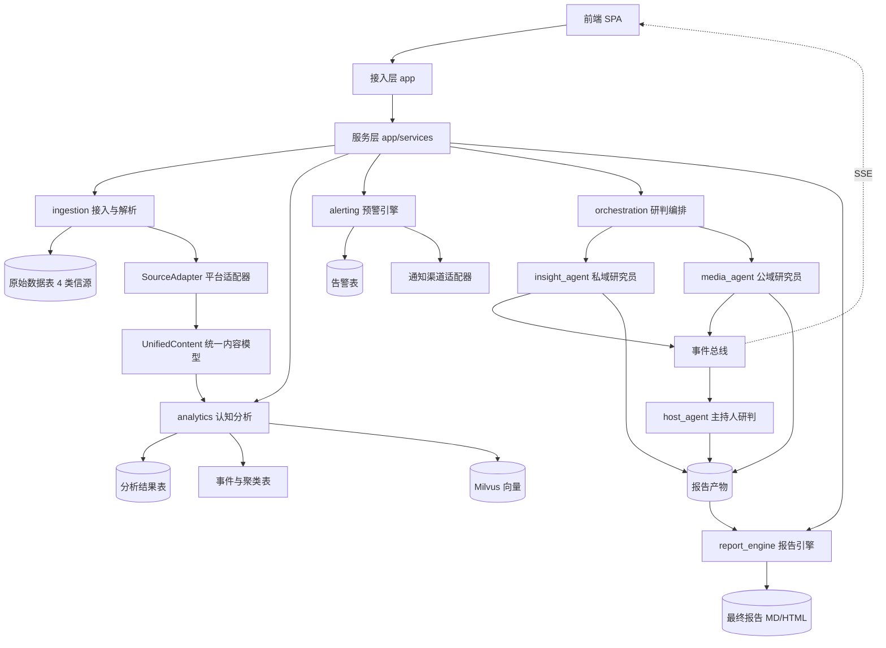
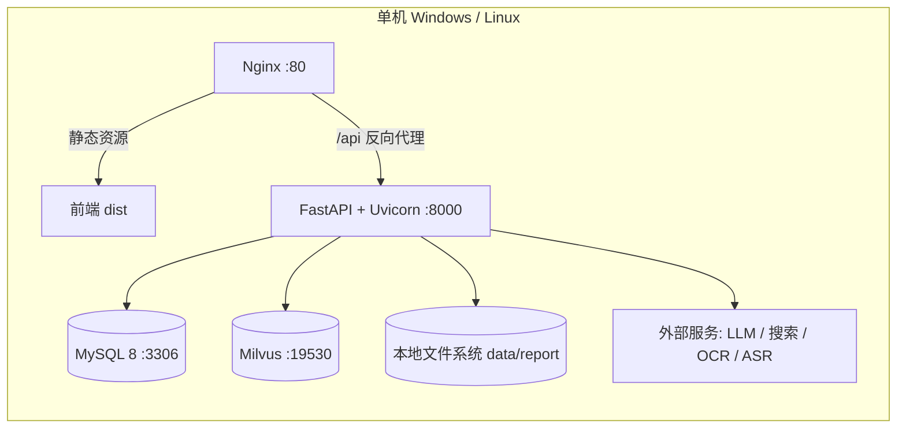
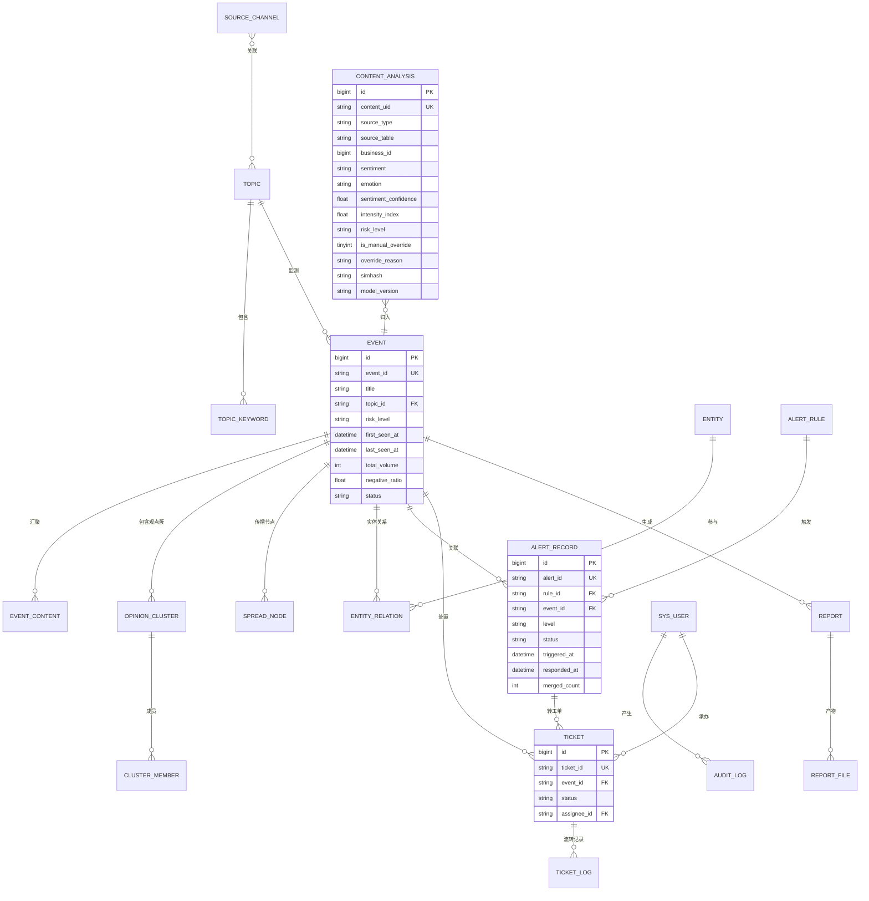
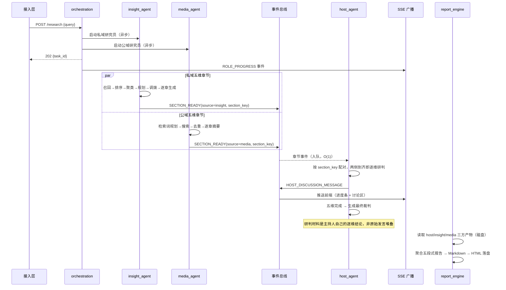
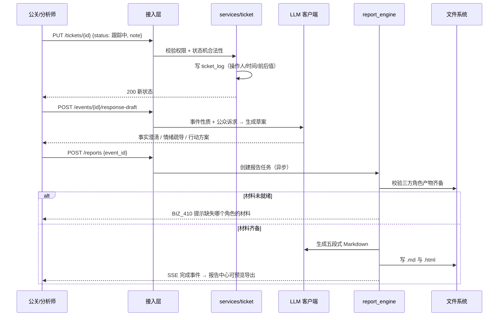

# 智能舆情分析平台 技术设计规格说明书（Design Spec）

> | 文档名称 | 技术设计规格说明书（Design Spec） |
> |----------|-----------------------------------|
> | 版本 | v0.2 |
> | 架构师角色 | 系统架构师 |
> | 日期 | 2026-10-14 |
> | 状态 | 评审稿 |
> | 依据 PRD | `docs/智能舆情分析平台-PRD.md` v0.2（评审稿） |
> | 参考实现 | 尚硅谷「舆情分析（多智能体）」课程架构（FastAPI + LangGraph） |
> | 已交付前置 | `data/` 模拟数据集（4 类信源、9 张表、评测集） |
> | 变更 | v0.2：冻结 Q2/Q3/Q4/Q6/Q7/Q8 六项技术决策（通知渠道、向量召回、OCR 接入方式、缓存、PDF 导出、分析口径一致性），详见第 11 章「已确认事项」 |

**需求回溯约定**：本文所有设计条目均标注对应的 PRD 功能编号（FR-xx）。凡课程参考实现已覆盖的部分标注「继承」，需在本项目新建的标注「新增」。

---

## 1. 架构设计概述

### 1.1 架构风格

**分层单体（Modular Monolith）+ 前后端分离 + 事件驱动的智能体编排**。

```
┌──────────────────────────────────────────────────────────────┐
│  前端 SPA（态势大盘 / 研判工作台 / 报告中心 / 监测配置）        │
│  REST + SSE                                                  │
└───────────────────────────┬──────────────────────────────────┘
                            │
┌───────────────────────────▼──────────────────────────────────┐
│  接入层 app/          路由 · 鉴权 · 参数校验 · SSE · 依赖注入   │
├──────────────────────────────────────────────────────────────┤
│  服务层 app/services/ 业务用例编排，聚合下层能力                │
├──────────────────────────────────────────────────────────────┤
│  引擎层 engines/                                              │
│  ┌────────────┬────────────┬─────────────┬─────────────────┐ │
│  │ ingestion  │ analytics  │  alerting   │  orchestration  │ │
│  │ 接入与解析  │ 认知分析    │  预警引擎    │   研判编排       │ │
│  └────────────┴────────────┴─────────────┴────────┬────────┘ │
│                                                    │          │
│  ┌──────────────┬──────────────┬──────────────┬────▼───────┐ │
│  │ insight_agent│ media_agent  │  host_agent  │report_engine│ │
│  │ 私域研究员    │ 公域研究员    │  主持人研判   │  报告引擎   │ │
│  └──────────────┴──────────────┴──────────────┴────────────┘ │
├──────────────────────────────────────────────────────────────┤
│  公共层 common/（事件总线 · LLM 客户端 · IO · 通用节点）        │
│  契约层 contracts/（配置 · 研究维度 · 证据模型 · 事件定义）      │
├──────────────────────────────────────────────────────────────┤
│  MySQL 8（原始/分析/业务数据）  Milvus（向量）  文件系统（报告） │
└──────────────────────────────────────────────────────────────┘
```

### 1.2 选型理由与权衡

| 决策 | 理由 | 放弃了什么 |
|------|------|-----------|
| **分层单体**而非微服务 | 单机演示环境（PRD 5. 非功能需求）、团队规模小、模块间调用频繁且需要共享事务；进程内调用延迟为零，调试链路短 | 放弃了独立扩缩容与故障隔离（详见 ADR-01） |
| **事件驱动**用于智能体协作 | 章节级结果需要「一侧产出即触发配对研判」，轮询会造成大量空转（FR-68） | 引入了事件订阅关系，链路需通过日志追踪 |
| **认知分析独立成层** | PRD 要求内容入库即打标（FR-20~FR-23），而课程把它放在 Agent 内部只服务于报告——**这是本项目相对参考实现最大的结构差异**（详见 ADR-02） | 增加了分析结果的持久化成本 |
| **原始表只读 + 分析结果独立存储** | 原始 4 类信源表是「外部采集产物」，不改写它们才能随时清空分析结果重跑（详见 ADR-03） | 查询需要 JOIN 或冗余 |
| **LangGraph 编排** | 各角色内部流程是「节点 + 状态 + 条件路由」的确定性图，用状态图表达比长函数可读（继承） | 引入了框架依赖与学习成本 |

---

## 2. 技术栈与依赖

### 2.1 技术栈

| 层 | 技术选型 | 用途 | 来源 |
|----|---------|------|------|
| 后端语言 | Python 3.11+（全异步 asyncio） | 服务与引擎 | 继承 |
| Web 框架 | FastAPI + Uvicorn | 路由、校验、生命周期 | 继承 |
| 数据校验 | Pydantic v2 | 请求响应模型、事件契约 | 继承 |
| 配置管理 | pydantic-settings + python-dotenv | `.env` 加载与热更新 | 继承 |
| ORM / 驱动 | SQLAlchemy 2.x + aiomysql | MySQL 异步访问 | 继承 |
| Agent 编排 | LangGraph | 角色内流程状态图 | 继承 |
| LLM 接入 | LangChain（OpenAI 兼容协议） | 统一客户端、结构化输出 | 继承 |
| 关系库 | MySQL 8（utf8mb4） | 原始 / 分析 / 业务数据 | 继承 |
| 向量库 | Milvus（pymilvus） | 语义召回 | 继承 |
| 向量编码 | 多语言 Embedding（BGE-M3 或等价） | 稠密 + 稀疏双向量 | 继承 |
| 聚类 | sentence-transformers + scikit-learn(KMeans) | 观点聚类 | 继承 |
| 关键词 | jieba（TF-IDF / TextRank） | 词云、关键词提取 | 继承 |
| 报告渲染 | mistune | Markdown → HTML | 继承 |
| 实时推送 | SSE（sse-starlette） | 进度与研判消息 | 继承 |
| 日志 | loguru | 结构化日志、按角色分流 | 继承 |
| 密码哈希 | passlib[bcrypt] 或 hashlib.scrypt | 用户口令 | **新增**（FR-01） |
| 会话鉴权 | itsdangerous 签名 Cookie 或 PyJWT | 登录态 | **新增**（FR-01） |
| 前端框架 | Vue 3 + Vite + TypeScript | SPA | 继承 |
| 前端状态 | Pinia | 全局状态 | 继承 |
| 图表 | ECharts | 折线 / 环形 / 词云 / 图谱 | 继承 |
| HTTP 客户端 | Axios | 前端 API 调用 | 继承 |
| 报告导出 PDF | 浏览器打印（前端触发 `window.print()` + `@media print` 样式） | PDF 导出，**零服务端依赖** | **新增**（FR-61，D-07） |
| OCR 接入 | **MCP 客户端**（官方 `mcp` SDK，SSE transport） | 调用云端 OCR 服务 | **新增**（FR-16，D-05） |
| 邮件发送 | Python 标准库 `smtplib` + `email.mime` | 预警邮件通知，**无需第三方依赖** | **新增**（FR-54，D-03） |
| 爬虫（第二期） | MediaCrawler（Playwright） | 真实信源采集 | **新增**（FR-15） |

### 2.2 第三方服务依赖

| 服务 | 用途 | 降级策略 | 来源 |
|------|------|---------|------|
| LLM 服务（OpenAI 兼容） | 情感与情绪识别、观点摘要、实体抽取、章节撰写、回应草案、报告生成 | 按角色独立配置；主模型失败切备用模型；关键路径失败输出兜底 | 继承（FR-71） |
| 公域搜索服务 | Tavily / Bocha / Anspire 三选一 | 适配器统一封装，可切换 | 继承 |
| 邮件通知 | SMTP 邮件服务（预警下发） | 发送失败重试 3 次后降级为纯站内消息，并在告警详情标注投递失败 | 新增（FR-54，**已定**：邮件优先，D-03） |
| OCR 服务 | **阿里云百炼 MCP 服务 `ai-ocr`**（SSE transport） | 连接超时 20s、调用失败标记 `failed` 状态，**不阻断入库**；本地降级为「无 OCR 文本」 | 新增（FR-16，**已定**：云服务，D-05） |
| ASR | **仅模拟测试接口**，不对接真实语音服务 | 返回预置转录文本，用于打通链路与前后端联调 | 新增（FR-17，**已定**：不实现真实功能，D-05） |

---

## 3. 模块 / 服务划分

### 3.1 模块拓扑



### 3.2 模块职责边界

| 模块 | 做什么 | 不做什么 |
|------|--------|---------|
| **接入层 `app/`** | HTTP 路由、请求响应模型校验、鉴权与权限校验、SSE 连接管理、依赖注入、统一异常处理 | 不实现业务逻辑；不直接访问数据库 |
| **服务层 `app/services/`** | 用例级编排（认证、主题、内容查询、事件研判、工单流转、报告任务、配置读写、大盘聚合）；组织多个引擎能力 | 不实现算法；不直接写 SQL |
| **`ingestion` 接入与解析**（FR-14~FR-19） | 从 9 张原始表读取内容；平台适配器做字段映射；多模态解析（OCR 走 MCP 云服务、ASR 走模拟接口）；文本清洗；SimHash 去重与水军识别；产出 UnifiedContent | 不做情感判断（交 analytics）；不判定风险；**不重试到阻塞接入**（解析失败即标记状态放行） |
| **`analytics` 认知分析**（FR-20~FR-35） | 情感三分类与情绪细分、烈度指数、风险分级、命名实体抽取、实体关系、语义聚类与事件归并、观点聚类、证据强度评估 | 不生成报告文案；不触发告警（交 alerting） |
| **`alerting` 预警引擎**（FR-52~FR-56） | 规则匹配、分级、告警去重收敛、通知下发、告警生命周期 | 不修改分析结果；不直接推送前端（经服务层） |
| **`orchestration` 研判编排**（FR-64~FR-71） | 按角色注册表启动分析角色；发布进度/结果/错误事件；管理 Host 运行时 | 不实现角色内部流程 |
| **`insight_agent` 私域研究员** | 面向私有舆情库：多路召回（关键词/评论/热度/语义）→ 排序 → 聚类 → 五维章节规划 → 证据调拨 → 逐章生成（继承） | **不重复做情感分析**（复用 analytics 的结果）；不访问公网 |
| **`media_agent` 公域研究员** | 面向公开搜索：五维检索词规划 → 搜索 → 证据归并去重 → 逐章摘要（继承） | 不访问私域库 |
| **`host_agent` 主持人研判** | 监听章节就绪事件；按维度配对 Insight/Media 结论；逐维研判（共识/分歧/风险）；汇总最终裁判（继承） | 不生成报告成品 |
| **`report_engine` 报告引擎**（FR-57~FR-63） | 读取三方角色产物聚合；生成五段式 Markdown；渲染 HTML；落盘与导出（继承，五段结构按 PRD 调整） | 不反向调用分析角色（只读磁盘） |
| **`common/`** | 事件总线、LLM 客户端与重试、进度回调、报告 IO、通用节点（排版/落盘） | 不含业务语义 |
| **`contracts/`** | 配置模型、五维研究维度、统一证据模型、事件定义、角色定义 | 不依赖任何上层模块 |

**依赖方向**：`contracts` ← `common` ← 各引擎 ← `services` ← `app`。`insight_agent` 与 `media_agent` **互不依赖**（课程「谁消费，谁定义；只共享，不强融」原则）。

### 3.3 PRD 功能覆盖对照

| PRD 模块 | 承载模块 | 覆盖 |
|---------|---------|------|
| M1 账号与权限（FR-01~05） | `app` + `services/auth` | 新增 |
| M2 监测配置（FR-06~13） | `services/topic` + `services/config` | 新增 |
| M3 数据接入与多模态（FR-14~19） | `ingestion` | 新增 |
| M4 认知分析（FR-20~35） | `analytics` | 新增（课程部分能力在 agent 内，需抽离） |
| M5 态势大盘（FR-36~41） | `services/dashboard` | 新增 |
| M6 研判工作台（FR-42~51） | `services/content` + `services/event` + `services/ticket` | 新增 |
| M7 预警引擎（FR-52~56） | `alerting` | 新增 |
| M8 报告中心（FR-57~63） | `report_engine` + `services/report` | 继承并扩展 |
| M9 多智能体研判（FR-64~71） | `orchestration` + 三 Agent | 继承 |
| M10 系统运维（FR-72~75） | `services/system` + 日志 | 新增 |

### 3.4 前端模块

| 模块 | 页面 | 关键交互 |
|------|------|---------|
| `views/dashboard` | 态势大盘（FR-36~41） | 图表下钻携带筛选条件跳转工作台；SSE 接收新告警 |
| `views/workbench` | 研判工作台（FR-42~51） | 多维筛选联动；卡片↔聚类↔时间线↔图谱互跳高亮 |
| `views/reports` | 报告中心（FR-57~63） | 生成进度（SSE）；Markdown 预览；PDF/MD 导出 |
| `views/config` | 监测配置（FR-06~13、FR-52~54） | 词包编辑、通道开关、阈值规则表单 |
| `views/login` | 登录 | 会话失效跳转 |
| `components/` | 复用组件 | `EventTimeline`、`OpinionClusterList`、`EntityGraph`、`RiskTag`、`SentimentDonut`、`ModalityViewer` |
| `stores/` | Pinia | `auth`、`topic`、`filter`、`realtime`（SSE 接续） |

---

## 4. 部署拓扑

### 4.1 开发与演示环境（本期）



- 单进程 Uvicorn（`--workers 1`）。**不使用多 worker**：事件总线与 Host 会话是进程内状态，多 worker 会导致事件只到达部分进程（见 ADR-05）。
- 前端构建产物由 Nginx 托管，`/api` 与 `/api/events/stream` 反向代理到后端。
- SSE 需在 Nginx 关闭缓冲：`proxy_buffering off; proxy_read_timeout 3600s;`

### 4.2 环境差异

| 环境 | 应用 | 数据库 | 向量库 | 说明 |
|------|------|--------|--------|------|
| dev | Uvicorn `--reload` | 本地 MySQL，`--scale small` 数据 | 默认关闭（`INSIGHT_VECTOR_ENABLED=false`） | 快速迭代 |
| test | 单进程 | 独立库，小样本数据 | 可选开启 | 冒烟与回归 |
| prod（演示） | Nginx + Uvicorn 单进程 | 独立库，`--scale prd` 数据 | 开启 | 演示前执行 `--scale prd` 放量 |

**未采用容器/K8s**：单机演示定位不需要，引入只会增加环境复杂度。若后续需容器化，`contracts/config.py` 已把连接信息全部外置到环境变量，可直接迁移。

---

## 5. 数据模型

### 5.1 分区策略

单库 `sentiment_monitor`，三类表并列，以命名区分：

| 分区 | 命名 | 写入方 | 说明 |
|------|------|--------|------|
| **原始区** | `weibo_note`、`weibo_note_comment`、`douyin_aweme`、`douyin_aweme_comment`、`news_article`、`news_article_comment`、`forum_thread`、`forum_post`、`platform_account` | 采集器（模拟数据已交付） | **本项目只读**，见 ADR-03 |
| **分析区** | `content_analysis`、`modality_asset`、`event`、`event_content`、`opinion_cluster`、`cluster_member`、`spread_node`、`entity`、`entity_relation` | `ingestion` + `analytics` | 可清空重跑 |
| **业务区** | `sys_user`、`audit_log`、`topic`、`topic_keyword`、`source_channel`、`alert_rule`、`alert_record`、`ticket`、`ticket_log`、`report`、`report_file` | 服务层 | 持久业务数据 |

### 5.2 核心实体关系



### 5.3 关键表设计要点

**`content_analysis`（分析区核心表）**

承载 PRD 的 `ANALYSIS_RESULT` 与 `CONTENT_RECORD` 的分析标签。设计要点：

- `content_uid` 是**跨信源统一标识**，格式 `{source_type}:{source_table}:{business_id}`，唯一索引。这是把 4 类异构信源表收敛为统一视图的关键。
- 只存**分析标签**，不冗余原始正文（正文仍在原始表）。查询时通过 `content_uid` 反查，或由服务层组装。
- 保留 `model_version`，模型或 Prompt 变更后可识别历史标签的生成版本。
- `is_manual_override` + `override_reason`：人工复核覆盖算法结论时**双份保留**（FR-24）。

**索引策略**（对应 PRD 5. 性能指标）：

| 表 | 索引 | 用途 |
|----|------|------|
| `content_analysis` | `uk_content_uid`、`idx_source_type`、`idx_sentiment`、`idx_risk_level` | 多维筛选（FR-43） |
| `content_analysis` | `idx_analyzed_at` | 大盘时间序列聚合 |
| 原始内容表 | 已含 `create_time` / `publish_time` / 业务 ID 索引（数据集已建） | 时间窗查询 |
| `event` | `uk_event_id`、`idx_topic_status`、`idx_risk_level` | 事件列表与筛选 |
| `alert_record` | `idx_status_triggered`、`idx_level` | 未读告警与滚动列表 |
| `report` | `idx_topic_generated` | 报告中心检索 |

**原始表的只读约束如何落实**：分析区写入时只 `INSERT` 到分析表；任何模块不得对 9 张原始表执行 `UPDATE`/`DELETE`。在 `services/content` 与 `analytics` 中禁止出现针对原始表的写操作（代码评审检查点）。

---

## 6. 关键接口定义

### 6.1 接口清单

| 编号 | 方法 | 路径 | 说明 | 对应 FR |
|------|------|------|------|---------|
| API-01 | POST | `/api/v1/auth/login` | 登录，返回会话 | FR-01 |
| API-02 | POST | `/api/v1/auth/logout` | 登出 | FR-01 |
| API-03 | GET | `/api/v1/topics` | 主题列表 | FR-06 |
| API-04 | POST | `/api/v1/topics` | 新建主题（含词包） | FR-06/07 |
| API-05 | PUT | `/api/v1/topics/{topic_id}` | 更新主题与词包 | FR-06/07 |
| API-06 | GET | `/api/v1/channels` | 信源通道状态 | FR-11/13 |
| API-07 | PUT | `/api/v1/channels/{channel_id}` | 启停通道 / 调整频率 | FR-11/12 |
| API-08 | GET | `/api/v1/contents` | 舆情动态流（多维筛选 + 分页） | FR-42/43 |
| API-09 | GET | `/api/v1/contents/{content_uid}` | 内容详情（原文 + OCR + ASR） | FR-44 |
| API-10 | GET | `/api/v1/events` | 事件专题列表 | FR-48 |
| API-11 | GET | `/api/v1/events/{event_id}` | 事件详情 | FR-48 |
| API-12 | GET | `/api/v1/events/{event_id}/timeline` | 传播溯源时间线 | FR-45 |
| API-13 | GET | `/api/v1/events/{event_id}/clusters` | 观点聚类 | FR-47 |
| API-14 | GET | `/api/v1/events/{event_id}/graph` | 实体关系图谱 | FR-46 |
| API-15 | PUT | `/api/v1/events/{event_id}/risk-level` | 风险等级人工复核 | FR-24 |
| API-16 | POST | `/api/v1/events/{event_id}/response-draft` | 生成公关回应草案 | FR-51 |
| API-17 | POST | `/api/v1/events/{event_id}/tickets` | 创建处置工单 | FR-49/50 |
| API-18 | PUT | `/api/v1/tickets/{ticket_id}` | 工单状态流转 | FR-49/50 |
| API-19 | GET | `/api/v1/alerts` | 告警列表 | FR-56 |
| API-20 | PUT | `/api/v1/alerts/{alert_id}` | 告警认领 / 关闭 | FR-56 |
| API-21 | GET | `/api/v1/dashboard/metrics` | 大盘指标聚合 | FR-36~41 |
| API-22 | POST | `/api/v1/research` | 发起多智能体研判 | FR-64~66 |
| API-23 | GET | `/api/v1/research/{task_id}` | 查询研判结果 | FR-64~66 |
| API-24 | GET | `/api/v1/events/stream` | **SSE** 实时进度与研判消息 | FR-69 |
| API-25 | POST | `/api/v1/reports` | 发起报告生成 | FR-58 |
| API-26 | GET | `/api/v1/reports` | 报告列表 | FR-57 |
| API-27 | GET | `/api/v1/reports/{report_id}` | 报告在线预览（HTML） | FR-60 |
| API-28 | GET | `/api/v1/reports/{report_id}/download` | 下载 PDF / Markdown | FR-61 |
| API-29 | GET/POST | `/api/v1/config` | 运行配置读取 / 热更新（白名单） | FR-53 |
| API-30 | POST | `/api/v1/admin/alerts/rules` | 预警规则维护 | FR-53 |

### 6.2 契约示例

**GET `/api/v1/contents`**（FR-42/43 多维筛选）

```yaml
get:
  summary: 舆情动态流
  parameters:
    - { name: topic_id,   in: query, schema: { type: string } }
    - { name: source_type, in: query, schema: { type: string, enum: [social_media, short_video, news_portal, industry_forum] } }
    - { name: sentiment,  in: query, schema: { type: string, enum: [positive, neutral, negative] } }
    - { name: risk_level, in: query, schema: { type: string, enum: [S, A, B, C] } }
    - { name: start_time, in: query, schema: { type: integer, description: "Unix 时间戳" } }
    - { name: end_time,   in: query, schema: { type: integer } }
    - { name: page,       in: query, schema: { type: integer, default: 1 } }
    - { name: page_size,  in: query, schema: { type: integer, default: 20, maximum: 100 } }
  responses:
    '200':
      content:
        application/json:
          schema:
            type: object
            properties:
              total: { type: integer }
              items:
                type: array
                items:
                  type: object
                  properties:
                    content_uid:    { type: string, example: "short_video:douyin_aweme:7648947265968639247" }
                    source_type:    { type: string }
                    platform_label: { type: string, example: "短视频" }
                    author_nickname:{ type: string }
                    text:           { type: string }
                    published_at:   { type: integer }
                    engagement:     { type: object, properties: { likes: {type: integer}, comments: {type: integer}, shares: {type: integer} } }
                    sentiment:      { type: string }
                    emotion:        { type: string }
                    risk_level:     { type: string }
                    intensity_index:{ type: number }
                    is_manual_override: { type: boolean }
    '401': { description: 未登录, 错误码: AUTH_001 }
```

**POST `/api/v1/research`**（FR-64~66）

```yaml
post:
  summary: 发起多智能体研判任务
  requestBody:
    content:
      application/json:
        schema:
          type: object
          required: [query]
          properties:
            query:    { type: string, example: "星耀XPhone15" }
            topic_id: { type: string }
            roles:    { type: array, items: { type: string, enum: [insight, media] }, default: [insight, media] }
  responses:
    '202':
      description: 任务已受理，进度经 SSE 推送
      content:
        application/json:
          schema: { type: object, properties: { task_id: {type: string}, started: {type: boolean} } }
    '409': { description: 已有研判任务在执行, 错误码: BIZ_409 }
```

**PUT `/api/v1/events/{event_id}/risk-level`**（FR-24 人工复核）

```yaml
put:
  summary: 人工复核风险等级（必须填写理由）
  requestBody:
    content:
      application/json:
        schema:
          type: object
          required: [risk_level, reason]
          properties:
            risk_level: { type: string, enum: [S, A, B, C] }
            reason:     { type: string, minLength: 5 }
  responses:
    '200': { description: 覆盖成功，算法原始结论仍可查 }
    '403': { description: 无权限（仅分析师与管理员）, 错误码: AUTH_003 }
```

### 6.3 错误码体系

| 段位 | 前缀 | 含义 | 示例 |
|------|------|------|------|
| 1xx | `AUTH_` | 认证与授权 | `AUTH_001` 未登录 / `AUTH_002` 会话过期 / `AUTH_003` 权限不足 |
| 2xx | `BIZ_` | 业务规则冲突 | `BIZ_201` 主题不存在 / `BIZ_409` 任务重复执行 / `BIZ_410` 上游材料未就绪 |
| 3xx | `ANA_` | 分析与模型 | `ANA_301` LLM 调用失败 / `ANA_302` 聚类样本不足 / `ANA_303` 解析失败 |
| 4xx | `EXT_` | 外部依赖 | `EXT_401` 搜索服务不可用 / `EXT_402` OCR 服务超时 / `EXT_403` 通知渠道失败 |
| 5xx | `SYS_` | 系统级 | `SYS_500` 未捕获异常 / `SYS_501` 数据库不可用 |

统一响应体：

```json
{ "code": "ANA_301", "message": "模型服务调用失败，请稍后重试", "detail": "role=insight, retries=4", "trace_id": "..." }
```

每层只抛本层错误码，接入层统一转换为 HTTP 状态并记录 `trace_id`。

---

## 7. 关键流程时序图

### 7.1 内容接入 → 解析 → 打标 → 预警（FR-14~23、FR-52）

```mermaid
sequenceDiagram
  participant SCH as 调度器
  participant ING as ingestion
  participant ADP as SourceAdapter
  participant OCR as OCR/ASR
  participant ANA as analytics
  participant DB as MySQL
  participant ALT as alerting
  participant NOTI as 通知渠道

  SCH->>ING: 触发采集周期（按 topic 词包）
  ING->>ADP: 读取 4 类信源原始表（时间窗 + 关键词）
  ADP-->>ING: 归一化为 UnifiedContent
  ING->>ING: 文本清洗 + SimHash 去重 + 水军识别
  opt 含图片/音视频
    ING->>OCR: 请求 OCR / ASR
    OCR-->>ING: 文本片段（失败则标记状态，不阻断）
  end
  ING->>ANA: 提交待打标内容
  ANA->>ANA: 情感 + 情绪 + 实体 + 烈度指数 + 风险等级
  ANA->>DB: 写 content_analysis / modality_asset
  ANA->>DB: 更新 event 归属与观点聚类
  ANA->>ALT: 发布"内容已打标"事件
  ALT->>ALT: 规则匹配（环比激增 / 敏感词 / 高权重账号）
  alt 命中规则
    ALT->>DB: 写 alert_record（去重合并）
    ALT->>NOTI: 推送告警（站内 + 外部渠道）
  end
```

### 7.2 多智能体研判（FR-64~71，继承课程章节级事件驱动）



### 7.3 处置与报告（FR-49~51、FR-57~63）



---

## 8. 非功能设计

### 8.1 安全（FR-02、FR-04）

| PRD 指标 | 设计手段 |
|---------|---------|
| 密码加盐哈希、不落明文 | `passlib[bcrypt]`（或 `hashlib.scrypt`）存储 `password_hash`；用户表不含任何可逆凭据 |
| 接口鉴权覆盖率 100% | FastAPI 依赖注入 `CurrentUser`；除 `/auth/login` 与健康检查外全部路由挂载；**默认拒绝**而非默认放行 |
| 角色权限校验 | 依赖 `require_role(*roles)` 装饰器；权限矩阵落成代码常量表（`PERMISSIONS`），与 PRD 第 2 章一一对应 |
| 日志不打印密钥 | loguru filter 过滤 `api_key` / `password` / `token` 字段；LLM 客户端异常信息脱敏后才记录 |
| 关键操作 100% 留痕 | 服务层统一审计装饰器 `@audit(action)`，写 `audit_log`（含 before/after 值）；覆盖登录、配置变更、工单流转、报告导出、风险复核 |
| 配置热更新白名单 | `/api/v1/config` 仅接受 `CONFIG_KEYS` 白名单内的键，其余拒绝（继承课程做法） |
| 数据合规 | 仅使用公开数据与项目交付的模拟数据集；不落库用户隐私敏感字段；`.env` 纳入 `.gitignore` |

### 8.2 性能（FR-36~43、58）

| PRD 指标 | 设计手段 |
|---------|---------|
| 列表/筛选/详情 P95 < 1s | 见 5.3 索引策略；统一分页且 `page_size ≤ 100`；列表接口不返回长文本（`text` 截断 200 字），详情接口才返回全文 |
| 大盘首屏 < 3s | 大盘聚合结果**定时物化**：`dashboard_metrics` 由后台任务每 60s 刷新一次，接口只读物化结果，不在请求内做全表聚合 |
| 单条打标 < 2s | 分析走异步队列，不阻塞接入；批量提交给 LLM 时按批并发（`asyncio.gather` + 信号量限流，默认并发 5） |
| 报告生成 ≤ 5min | 章节级并行 + 磁盘产物复用；报告生成只聚合已有材料，不触发重新分析 |
| 预警 ≤ 3min | 采集周期可配置（默认 5min）；打标完成后立即发布事件，告警检测是事件驱动而非轮询 |
| 并发 20 用户 / 50 QPS | 只读接口无状态可水平扩展；`uvicorn --workers 1` 的写入瓶颈在 LLM 调用而非 DB，通过异步并发覆盖 |
| 全链路可定位 | 每请求生成 `trace_id`（透传至日志、审计、LLM 调用记录），日志按 `trace_id` 可串起完整调用链 |

**缓存策略**：本期不引入 Redis。物化表（`dashboard_metrics`）承担大屏聚合缓存；词包与配置在进程内以 `lru_cache` + 配置变更时失效。若并发压测不达标再引入 Redis（见 11. 待明确事项）。

### 8.3 高可用与容错（FR-70、PRD 5. 可用性）

| 要求 | 设计手段 |
|------|---------|
| 单组件故障不影响历史数据读取 | 报告产物落盘为文件；LLM/搜索失败不影响已入库内容与已生成报告的查询 |
| 外部依赖失败有降级与提示 | LLM：按角色独立配置 + 主备切换 + 指数退避重试（跳过非 429 的 4xx）；搜索：三供应商适配器可切换；OCR/ASR：失败标记状态不阻断入库 |
| 不出现白屏或静默失败 | 前端统一错误边界；接口错误码可读；SSE 断开自动重连（`EventSource` 原生重连 + 前端指数退避） |
| 关键路径失败不整体中断 | 关键路径用柔性重试（返回兜底结果）；非关键路径用刚性重试（失败即中断该角色并上报 `ROLE_ERROR`） |
| 告警通知投递失败 | 邮件发送失败按 5s/15s/45s 重试 3 次；仍失败则降级为纯站内消息，并在告警详情标注「邮件投递失败」。**告警记录本身必须先落库再通知**，不能因通知失败而丢失告警 |
| OCR 服务不可用 | 超时 20s 后标记 `modality_asset.status=failed` 并放行，内容照常进入打标与展示流程；OCR 是增强项而非必需项 |
| 演示数据可复原 | `data/generator/generate.py` 一键重建；提供 `--end-time` 固定锚点保证多次生成一致（FR-75） |

**单点说明**：MySQL 与 Milvus 在演示环境为单实例，无主从。这是单机定位的已知限制，不作为缺陷处理。

### 8.4 可观测（FR-72~73）

| 维度 | 手段 |
|------|------|
| 日志 | loguru；按角色分流到 `logs/{role}.log`；`rotation` 按大小滚动；结构化字段含 `trace_id` / `task_id` / `role` |
| 任务状态 | `task_run` 表记录采集/分析/研判/报告任务的开始、结束、状态、耗时、错误摘要（FR-72） |
| 健康检查 | `GET /healthz`（存活）与 `GET /readyz`（依赖连通性：DB / Milvus / LLM 探测） |
| 日志检索 | 服务层提供按模块/时间/关键字检索 `task_run` 与日志文件（FR-73） |
| 指标 | 本期不引入 Prometheus；以 `task_run` 表 + 大盘指标卡承载（见 11. 待明确事项） |

---

## 9. 设计决策记录（ADR）

### ADR-01：采用分层单体而非微服务

| 项 | 内容 |
|----|------|
| **背景** | PRD 定位为课程实战 / 毕设级可运行系统，非功能目标是 20 并发、50 QPS、SLA 99%（单机演示环境） |
| **选项** | A. 微服务（按接入/分析/预警/报告拆 4~5 个服务）；B. 分层单体（一个进程内分层） |
| **决定** | **B 分层单体** |
| **理由** | ① 演示环境单机部署，微服务带来的网络调用、服务发现、链路追踪成本收益为负；② 模块间调用频繁（接入→分析→预警每条内容都走一遍），进程内调用延迟为零；③ 参考实现即单体分层，团队熟悉；④ 通过「模块边界 + 依赖方向约束」保留拆分可能性 |
| **后果** | 无法独立扩缩容；单进程故障影响全部功能；**必须保持模块边界的纪律**——跨模块直接访问对方内部实现会迅速退化为大泥球。缓解：模块间只通过 `contracts` 定义的契约通信 |

### ADR-02：认知分析独立成层，而非放在 Agent 内部

| 项 | 内容 |
|----|------|
| **背景** | 参考实现（课程）把情感分析、聚类放在 `insight_agent` 内部，因为它只服务于「生成报告」这一目标。但 PRD 要求：内容入库即打标（FR-20~21），供大盘情感分布（FR-37）、工作台筛选（FR-43）、预警规则匹配（FR-52）使用。这些场景都**不经过 Agent** |
| **选项** | A. 沿用课程：Agent 内做分析，其他场景复用 Agent 输出；B. 抽出独立 `analytics` 层，Agent 与其他模块共同消费其结果 |
| **决定** | **B 抽出独立层** |
| **理由** | ① 调用时机不同：打标发生在**入库时**（每条内容），Agent 分析发生在**用户发起研判时**（按需），两者生命周期完全不同；② 消费方不同：大屏/筛选/预警都需要标签，但它们不启动 Agent；③ 若沿用 A，大盘要么无法实时反映新内容，要么被迫为每条内容跑一次完整的 Agent 流程——成本不可接受 |
| **后果** | 需要 `content_analysis` 持久化表与 `content_uid` 统一标识；`insight_agent` 需改为**复用** analysis 层的结果而非重复计算（避免两套情感判断标准）；这是相对参考实现最大的结构改动，编码时容易不自觉地把分析逻辑写回 Agent 内 |

### ADR-03：原始数据表只读，分析结果独立存储

| 项 | 内容 |
|----|------|
| **背景** | 4 类信源的 9 张原始表结构异构（字段命名、时间格式、层级关系都不同），且它们是"采集器写入的产物" |
| **选项** | A. 在原表上直接加分析字段（`sentiment`、`risk_level` 等列）；B. 分析结果写独立表，通过统一标识关联 |
| **决定** | **B 独立存储** |
| **理由** | ① 原表是外部系统产物，本项目不应修改其结构（第二期接入真实爬虫时，表结构由采集器决定）；② 分析模型/Prompt 迭代时需要**清空重跑**，独立表可 `TRUNCATE` 后重算，不触碰原始数据；③ 4 类异构表若各自加字段，等于把平台差异扩散到分析层，违背"接入层做映射"的设计；④ 统一表使跨信源查询（大盘、筛选）只需查一张表 |
| **后果** | 查询需 JOIN 或由服务层组装（列表接口只返回分析表字段 + 从原表取文本片段，两段查询而非 JOIN，因为跨 4 张异构表 JOIN 无法用单条 SQL 表达）；增加了存储冗余 |

### ADR-04：LangGraph 编排 + 章节级事件驱动的配对研判

| 项 | 内容 |
|----|------|
| **背景** | 两个分析角色各产出五维章节，主持人需要把「同一维度的两个来源结论」放在一起比较。若等全部章节完成后统一研判，会损失过程可见性且延迟高 |
| **选项** | A. 自研顺序编排（函数调用链）；B. LangGraph 状态图 + 章节完成即发布事件，主持人按维度配对 |
| **决定** | **B**（继承参考实现） |
| **理由** | ① 角色内部流程是确定的「节点 + 条件路由」（召回→排序→聚类→规划→调拨→**游标循环逐章生成**→排版→落盘），状态图表达比长函数清晰，循环与条件分支显式可见；② 章节级事件让主持人在两侧同维章节到齐时立即研判，前端可实时看到讨论过程（FR-69）；③ 参考实现已验证该模式可行 |
| **后果** | 需要维护 `PairStore`（按 `section_key` 配对、防重复研判、低质量重复择优）；主持人状态需要区分「单次图调用的 State」与「跨事件累积的 Session」两层；已知限制：查询维度为单查询设计，跨主题需重置会话 |

### ADR-05：进程内事件总线，不引入消息队列

| 项 | 内容 |
|----|------|
| **背景** | 系统存在多条事件流：章节就绪、角色进度、角色结果/错误、主持人讨论消息 |
| **选项** | A. 引入 RabbitMQ / Redis Pub-Sub；B. 进程内发布订阅（`dict[EventType, set[callback]]`） |
| **决定** | **B 进程内事件总线**（继承参考实现） |
| **理由** | ① 单进程部署（ADR-01），事件无需跨进程；② 事件是**运行时可观测性**用途（进度、讨论消息），不是业务事实的可靠传递——丢失一条进度事件不影响正确性；③ 引入 MQ 需额外的运维组件与序列化成本，收益为零 |
| **后果** | **致命约束：必须 `--workers 1`**，多 worker 会导致事件只到达持有订阅者的那个进程；进程重启丢失未处理事件（缓解：报告材料落盘，重启后可从磁盘恢复）；**若未来引入 MQ**（多副本部署时必然），需把 `common/eventing` 的 publish/subscribe 换成 MQ 客户端，接口保持不变即可平滑替换 |

### ADR-06：多模态解析可插拔 + 失败不阻断

| 项 | 内容 |
|----|------|
| **背景** | PRD 要求图片 OCR（FR-16）与音视频 ASR（FR-17）解析。已定方案：OCR 采用云端服务（D-05），ASR 本期仅做模拟测试接口（D-05）。OCR 属外部依赖，可能超时、限流或不可用 |
| **选项** | A. 在接入流程内同步调用 OCR，失败则整条内容入库失败；B. 定义 `ModalityParser` 接口，OCR 为真实实现、ASR 为模拟实现，解析结果独立存储且失败不阻断 |
| **决定** | **B 可插拔 + 失败不阻断** |
| **理由** | ① 解析是慢操作（网络往返），**不能阻断内容入库**——OCR 服务不可用就导致整条采集链路停摆是不可接受的；② OCR/ASR 结果是**独立证据记录**（`modality_asset`），与原文并列进入证据池，而非替换原文；③ ASR 本期是模拟实现，接口化后将来接真实语音服务只需替换实现类 |
| **后果** | 需要 `modality_asset` 表与解析状态字段（`pending` / `success` / `failed`）；`analytics` 需能处理"仅有 OCR 文本、无有效原文"的内容；**演示时必须明确标注 ASR 为模拟数据**，不得对外表述为具备真实语音转写能力 |

### ADR-07：OCR 通过 MCP 协议接入云端服务

| 项 | 内容 |
|----|------|
| **背景** | OCR 选用阿里云百炼的 `ai-ocr` MCP 服务（D-05），该能力以 SSE transport 的 MCP Server 形式暴露，项目需以编程方式调用 |
| **选项** | A. 直接对接底层 HTTP API（若可绕过）；B. 用官方 `mcp` Python SDK 以 SSE transport 连接该 MCP 服务 |
| **决定** | **B MCP 客户端接入** |
| **理由** | ① 该能力本身就以 MCP 协议暴露，用 MCP 客户端是唯一无需逆向其私有 HTTP 格式的方式；② MCP 是工具调用的通用协议，**将来更换 OCR 供应商时，替换的只是一个 URL**；③ 工具名与入参 schema 通过 `list_tools()` 动态发现，供应商调整签名时会明确报错而非静默返回错误结果 |
| **实现要点** | 见附录 C 的调用骨架。关键纪律：**先 `list_tools()` 再 `call_tool()`，不得硬编码工具名** |
| **后果** | 引入 `mcp` 依赖；SSE 是长连接，每次调用新建连接开销大，`ingestion` 内应维护单例会话并在断开时重建；`Authorization` 头携带密钥，**日志必须脱敏**（与 8.1 的密钥脱敏要求一致） |

---

## 10. 任务分解清单

按依赖顺序排列。**T-01~T-06 可并行启动**（互无依赖）；分析链路（T-07~T-12）与研判链路（T-13~T-18）**可并行推进**，在 T-19 汇合。

### 阶段一：地基

| 编号 | 模块 | 依赖 | 说明 |
|------|------|------|------|
| T-01 | 工程骨架 | 无 | 目录结构、`pyproject.toml`、`contracts/config.py`（Settings + `.env` 加载）、`main.py` 启动器、日志初始化 |
| T-02 | 数据库 | 无 | 分析区与业务区建表 DDL（`sql/business/`、`sql/analysis/`）、SQLAlchemy 模型与异步 session 工厂、连接池配置 |
| T-03 | 事件总线 | 无 | `common/eventing`：bus + publishers + 五类事件 Pydantic 契约 |
| T-04 | LLM 客户端 | 无 | `common/llm_client`：按角色配置、门面（文本/结构化）、重试装饰器、脱敏日志 |
| T-05 | 统一契约 | 无 | `contracts`：五维维度定义、`UnifiedContent`、`EvidenceRecord`、角色注册表 |
| T-06 | 前端骨架 | 无 | Vite + Vue3 + TS、路由、Pinia、Axios 封装（含错误码处理）、登录页与鉴权守卫 |

### 阶段二：数据与分析链路

| 编号 | 模块 | 依赖 | 说明 |
|------|------|------|------|
| T-07 | 平台适配器 | T-05 | 4 类信源 → `UnifiedContent` 的字段映射（**含两平台命名差异收敛**，这是 FR-14 的核心） |
| T-08 | 接入与清洗 | T-07 | 关键词召回、时间窗过滤、文本清洗、SimHash 去重、水军识别（FR-14/18/19） |
| T-09 | 多模态解析 | T-08 | `ModalityParser` 接口；OCR 用 MCP 客户端接云端服务；ASR 模拟实现；`modality_asset` 落库与失败标记（FR-16/17，见附录 C） |
| T-10 | 情感与风险 | T-05, T-02 | 情感三分类、情绪细分、烈度指数、风险分级（FR-20~24）；**权重从配置读取**（对应 PRD Q1） |
| T-11 | 实体与聚类 | T-10 | 命名实体抽取、实体关系、语义聚类与事件归并、观点聚类、证据强度（FR-25~28/34） |
| T-12 | 向量召回 | T-11 | Milvus 集合定义、Embedding 同步、混合检索 + RRF 融合（FR-27）。**首版必需**（D-04），在关键路径上 |

### 阶段三：研判链路

| 编号 | 模块 | 依赖 | 说明 |
|------|------|------|------|
| T-13 | 私域研究员 | T-05, T-12 | LangGraph 八节点：召回→排序→聚类→规划→调拨→游标逐章→排版→落盘（FR-64/67/68） |
| T-14 | 公域研究员 | T-05, T-04 | 五节点：规划→搜索→游标逐章→排版→落盘；搜索供应商适配器（FR-65） |
| T-15 | 主持人研判 | T-13, T-14 | `PairStore` 配对、逐维研判、最终裁判、会话双层状态（FR-66） |
| T-16 | 研判编排 | T-13, T-14 | 角色注册表、并行启动、进度事件发布（FR-68/69/71） |
| T-17 | 报告引擎 | T-15 | 三方产物加载、五段式结构组装、Markdown 生成、HTML 渲染、落盘（FR-57~62） |
| T-18 | SSE 广播 | T-03 | 订阅进度/结果/错误事件，扇出到 SSE 连接（FR-69） |

### 阶段四：业务能力

| 编号 | 模块 | 依赖 | 说明 |
|------|------|------|------|
| T-19 | 认证与权限 | T-02, T-06 | 用户表、密码哈希、会话、`CurrentUser` 依赖、`require_role`、权限矩阵（FR-01~03） |
| T-20 | 审计日志 | T-19 | `@audit` 装饰器、`audit_log` 落库（FR-04） |
| T-21 | 监测配置 | T-19 | 主题与词包 CRUD、通道开关、配置热更新白名单（FR-06~13/29） |
| T-22 | 内容查询 | T-08, T-10, T-19 | 多维筛选 + 分页、详情组装（原文 + OCR + ASR）（FR-42~44） |
| T-23 | 事件与溯源 | T-11, T-22 | 事件专题、溯源时间线、观点聚类列表、实体图谱数据（FR-45~48） |
| T-24 | 预警引擎 | T-10, T-03 | 规则匹配、分级、去重收敛、**邮件 + 站内**通知下发（`smtplib`）、生命周期（FR-52~56） |
| T-25 | 处置工单 | T-23 | 状态机（待研判→跟踪中→已核实→辟谣处置→已处理/已忽略）、流转记录、回应草案生成（FR-49~51） |
| T-26 | 态势大盘 | T-22, T-24 | 指标物化任务、趋势/情感分布/词云/告警滚动接口（FR-36~41） |
| T-27 | 报告中心服务 | T-17, T-19 | 报告任务管理、列表、预览、Markdown 下载与**前端浏览器打印导出 PDF**（FR-57~63，D-07） |
| T-28 | 系统运维 | T-02 | 任务状态表、日志检索、数据重置入口（FR-72~75） |

### 阶段五：前端页面

| 编号 | 模块 | 依赖 | 说明 |
|------|------|------|------|
| T-29 | 态势大盘页 | T-26, T-06 | ECharts 折线/环形/词云、告警滚动列表、SSE 接入、下钻跳转 |
| T-30 | 研判工作台页 | T-22, T-23, T-06 | 卡片流 + 多维筛选联动 + 时间线/聚类/图谱三视区 |
| T-31 | 处置协同区 | T-25 | 状态流转表单、批注、回应草案编辑与采纳 |
| T-32 | 报告中心页 | T-27 | 预览、进度、导出 |
| T-33 | 监测配置页 | T-21 | 词包编辑、通道开关、阈值规则表单 |

### 阶段六：贯通与交付

| 编号 | 模块 | 依赖 | 说明 |
|------|------|------|------|
| T-34 | 端到端联调 | 全部 | 用 `--scale prd` 数据跑通「监测→预警→研判→处置→报告」全链路（PRD 9.2） |
| T-35 | 评测与调优 | T-10, T-11 | 用 `data/eval/` 两个评测集评估，达标线 SC-02 ≥85%、SC-03 ≥80% |
| T-36 | 部署与文档 | T-34 | Nginx 配置、启动脚本、README、演示脚本 |

**关键路径**：T-01 → T-05 → T-07 → T-08 → T-10 → T-11 → T-12 → T-13/T-14 → T-15 → T-17 → T-27 → T-34。

---

## 11. 已确认事项与待明确事项

### 11.1 已确认事项（2026-10-14）

| 编号 | 事项 | 结论 | 影响范围 |
|------|------|------|---------|
| D-03 | 预警外发通知渠道 | **邮件优先**，发送至 `1028925770@qq.com`；站内消息保留为兜底 | T-24 只实现邮件适配器；技术栈增加 `smtplib` |
| D-04 | 向量召回 | **纳入首版**，Milvus 为必需组件 | T-12 进入关键路径；部署拓扑含 Milvus |
| D-05 | 多模态解析 | OCR 采用**阿里云百炼 `ai-ocr` MCP 服务**（SSE transport）；ASR **仅实现模拟测试接口**，不对接真实语音服务 | T-09；ADR-06/ADR-07；技术栈增加 `mcp` |
| D-06 | 缓存与分布式锁 | **不引入 Redis**，沿用指标物化表 + 进程内缓存 | 部署拓扑保持四组件 |
| D-07 | 报告 PDF 导出 | **浏览器打印**（前端 `window.print()` + `@media print`），零服务端依赖 | T-27；不引入 weasyprint |
| D-08 | 分析口径一致性 | `insight_agent` **一律复用 `analytics` 的标签，不重复计算** | T-13 的实现纪律，见 ADR-02 |

### 11.2 待明确事项

| 编号 | 问题 | 建议确认方 | 影响 |
|------|------|-----------|------|
| Q1 | **烈度指数四项权重**（负向 / 声量 / KOL / 敏感）的最终取值。当前按 `0.50 / 0.30 / 0.12 / 0.15` 实现，并外置为配置项 | 业务方 / 分析师 | 直接决定风险分级与评测集标签，变更需重跑 `risk_eval` |
| Q2 | **QQ 邮箱 SMTP 授权码**。QQ 邮箱发信需使用「授权码」而非登录密码：登录 QQ 邮箱 → 设置 → 账户 → 开启 SMTP 服务后生成 | 项目负责人 | 阻塞 T-24 邮件通道联调；未取得前可先跑通站内消息 |
| Q3 | 第二期真实采集的合规边界（可采集平台范围、是否需授权、是否需脱敏后入库） | 法务 / 业务方 | 影响采集器模块设计 |
| Q4 | **中文 Embedding 模型选型**：BGE-M3 本地部署（占显存、需下载权重）vs 云端 Embedding API（有调用成本、数据外发） | 架构评审 | 影响 T-12 的实现方式与部署资源 |

> **D-08 的执行纪律**：这是最容易在编码时被违反的一条——参考实现的 `insight_agent` 内部本就有情感提炼逻辑，
> 直接搬运会造成"大屏显示负向 60%、报告里写负向 45%"的自相矛盾。
> 建议在 T-13 开工前写入代码评审检查项：**`insight_agent` 内不得出现任何独立的情感判定代码**。

---

## 附录 A：核心表 DDL

以下为分析区与业务区的核心表建表语句，命名与类型习惯与已交付的原始表保持一致（反引号包裹、utf8mb4、时间戳与日期字符串双写）。
完整 DDL 在 T-02 产出，本附录作为字段级设计的基线。

```sql
-- ============ 业务区 ============

CREATE TABLE `sys_user` (
  `id` int NOT NULL AUTO_INCREMENT COMMENT '主键ID',
  `user_id` varchar(64) NOT NULL COMMENT '用户业务ID',
  `username` varchar(64) NOT NULL COMMENT '登录名',
  `password_hash` varchar(255) NOT NULL COMMENT '口令哈希（bcrypt/scrypt）',
  `display_name` varchar(128) DEFAULT NULL COMMENT '显示名称',
  `role` varchar(32) NOT NULL COMMENT '角色：analyst/pr/Admin',
  `status` varchar(16) NOT NULL DEFAULT 'active' COMMENT '状态：active/disabled',
  `created_at` bigint NOT NULL COMMENT '创建时间戳',
  `last_login_at` bigint DEFAULT NULL COMMENT '最后登录时间戳',
  PRIMARY KEY (`id`),
  UNIQUE KEY `uk_sys_user_username` (`username`),
  UNIQUE KEY `uk_sys_user_user_id` (`user_id`)
) ENGINE=InnoDB DEFAULT CHARSET=utf8mb4 COMMENT='系统用户';

CREATE TABLE `audit_log` (
  `id` bigint NOT NULL AUTO_INCREMENT COMMENT '主键ID',
  `user_id` varchar(64) DEFAULT NULL COMMENT '操作人',
  `action` varchar(64) NOT NULL COMMENT '动作：login/config_update/ticket_flow/report_export/risk_override',
  `target` varchar(255) DEFAULT NULL COMMENT '操作对象',
  `before_value` text COMMENT '变更前值',
  `after_value` text COMMENT '变更后值',
  `ip` varchar(64) DEFAULT NULL COMMENT '来源IP',
  `operated_at` bigint NOT NULL COMMENT '操作时间戳',
  PRIMARY KEY (`id`),
  KEY `ix_audit_log_user_time` (`user_id`, `operated_at`),
  KEY `ix_audit_log_action` (`action`)
) ENGINE=InnoDB DEFAULT CHARSET=utf8mb4 COMMENT='操作审计日志';

CREATE TABLE `topic` (
  `id` int NOT NULL AUTO_INCREMENT COMMENT '主键ID',
  `topic_id` varchar(64) NOT NULL COMMENT '主题业务ID',
  `name` varchar(128) NOT NULL COMMENT '主题名称',
  `description` text COMMENT '主题描述',
  `owner_id` varchar(64) NOT NULL COMMENT '负责人用户ID',
  `status` varchar(16) NOT NULL DEFAULT 'enabled' COMMENT '状态：enabled/disabled',
  `start_at` bigint DEFAULT NULL COMMENT '生效时间戳',
  `created_at` bigint NOT NULL COMMENT '创建时间戳',
  PRIMARY KEY (`id`),
  UNIQUE KEY `uk_topic_topic_id` (`topic_id`),
  KEY `ix_topic_owner` (`owner_id`)
) ENGINE=InnoDB DEFAULT CHARSET=utf8mb4 COMMENT='监测主题';

CREATE TABLE `topic_keyword` (
  `id` int NOT NULL AUTO_INCREMENT COMMENT '主键ID',
  `topic_id` varchar(64) NOT NULL COMMENT '所属主题',
  `word` varchar(128) NOT NULL COMMENT '关键词',
  `group_type` varchar(16) NOT NULL COMMENT '分组：brand/event/competitor/exclude',
  `weight` decimal(4,2) NOT NULL DEFAULT 1.00 COMMENT '权重',
  PRIMARY KEY (`id`),
  KEY `ix_topic_keyword_topic` (`topic_id`, `group_type`)
) ENGINE=InnoDB DEFAULT CHARSET=utf8mb4 COMMENT='主题词包';

-- ============ 分析区 ============

CREATE TABLE `content_analysis` (
  `id` bigint NOT NULL AUTO_INCREMENT COMMENT '主键ID',
  `content_uid` varchar(255) NOT NULL COMMENT '跨信源统一标识 {source_type}:{source_table}:{business_id}',
  `source_type` varchar(32) NOT NULL COMMENT '信源类型',
  `source_table` varchar(64) NOT NULL COMMENT '来源原始表名',
  `business_id` bigint NOT NULL COMMENT '原始表业务ID',
  `topic_id` varchar(64) DEFAULT NULL COMMENT '归属监测主题',
  `sentiment` varchar(16) NOT NULL COMMENT '情感：positive/neutral/negative',
  `emotion` varchar(16) DEFAULT NULL COMMENT '细分情绪：愤怒/失望/恐慌/质疑',
  `sentiment_confidence` decimal(5,4) DEFAULT NULL COMMENT '情感置信度',
  `intensity_index` decimal(5,4) DEFAULT NULL COMMENT '舆情烈度指数 0~1',
  `risk_level` varchar(2) DEFAULT NULL COMMENT '风险等级：S/A/B/C',
  `is_manual_override` tinyint NOT NULL DEFAULT 0 COMMENT '是否人工覆盖',
  `override_reason` text COMMENT '人工调整理由',
  `simhash` varchar(64) DEFAULT NULL COMMENT 'SimHash 指纹',
  `is_suspected_bot` tinyint NOT NULL DEFAULT 0 COMMENT '疑似水军',
  `model_version` varchar(64) DEFAULT NULL COMMENT '标签生成模型版本',
  `analyzed_at` bigint NOT NULL COMMENT '打标时间戳',
  PRIMARY KEY (`id`),
  UNIQUE KEY `uk_content_analysis_uid` (`content_uid`),
  KEY `ix_content_analysis_filter` (`source_type`, `sentiment`, `risk_level`),
  KEY `ix_content_analysis_time` (`analyzed_at`),
  KEY `ix_content_analysis_topic` (`topic_id`)
) ENGINE=InnoDB DEFAULT CHARSET=utf8mb4 COMMENT='内容分析标签';

CREATE TABLE `event` (
  `id` bigint NOT NULL AUTO_INCREMENT COMMENT '主键ID',
  `event_id` varchar(64) NOT NULL COMMENT '事件业务ID',
  `title` varchar(255) NOT NULL COMMENT '事件标题',
  `topic_id` varchar(64) DEFAULT NULL COMMENT '归属主题',
  `risk_level` varchar(2) DEFAULT NULL COMMENT '风险等级 S/A/B/C',
  `first_seen_at` bigint DEFAULT NULL COMMENT '首次出现时间戳',
  `last_seen_at` bigint DEFAULT NULL COMMENT '最近出现时间戳',
  `total_volume` int NOT NULL DEFAULT 0 COMMENT '总声量',
  `negative_ratio` decimal(5,4) DEFAULT NULL COMMENT '负面率',
  `status` varchar(16) NOT NULL DEFAULT 'monitoring' COMMENT '状态：monitoring/alerting/handling/resolved',
  `created_at` bigint NOT NULL COMMENT '创建时间戳',
  PRIMARY KEY (`id`),
  UNIQUE KEY `uk_event_event_id` (`event_id`),
  KEY `ix_event_topic_status` (`topic_id`, `status`),
  KEY `ix_event_risk` (`risk_level`)
) ENGINE=InnoDB DEFAULT CHARSET=utf8mb4 COMMENT='事件专题';

CREATE TABLE `alert_rule` (
  `id` int NOT NULL AUTO_INCREMENT COMMENT '主键ID',
  `rule_id` varchar(64) NOT NULL COMMENT '规则业务ID',
  `rule_type` varchar(32) NOT NULL COMMENT '类型：negative_surge/sensitive_hit/kol_voice',
  `threshold` decimal(10,4) DEFAULT NULL COMMENT '阈值',
  `sensitive_words` text COMMENT '敏感词库（rule_type=sensitive_hit）',
  `level` varchar(2) NOT NULL COMMENT '触发等级 S/A/B/C',
  `enabled` tinyint NOT NULL DEFAULT 1 COMMENT '是否启用',
  PRIMARY KEY (`id`),
  UNIQUE KEY `uk_alert_rule_rule_id` (`rule_id`)
) ENGINE=InnoDB DEFAULT CHARSET=utf8mb4 COMMENT='预警规则';

CREATE TABLE `alert_record` (
  `id` bigint NOT NULL AUTO_INCREMENT COMMENT '主键ID',
  `alert_id` varchar(64) NOT NULL COMMENT '告警业务ID',
  `rule_id` varchar(64) DEFAULT NULL COMMENT '触发规则',
  `event_id` varchar(64) DEFAULT NULL COMMENT '关联事件',
  `level` varchar(2) NOT NULL COMMENT '等级',
  `status` varchar(16) NOT NULL DEFAULT 'unread' COMMENT '状态：unread/read/claimed/closed',
  `triggered_at` bigint NOT NULL COMMENT '触发时间戳',
  `responded_at` bigint DEFAULT NULL COMMENT '响应时间戳',
  `merged_count` int NOT NULL DEFAULT 1 COMMENT '同事件合并计数',
  `detail` text COMMENT '触发明细（各因子取值）',
  PRIMARY KEY (`id`),
  UNIQUE KEY `uk_alert_record_alert_id` (`alert_id`),
  KEY `ix_alert_record_status_time` (`status`, `triggered_at`),
  KEY `ix_alert_record_level` (`level`)
) ENGINE=InnoDB DEFAULT CHARSET=utf8mb4 COMMENT='告警记录';

CREATE TABLE `ticket` (
  `id` bigint NOT NULL AUTO_INCREMENT COMMENT '主键ID',
  `ticket_id` varchar(64) NOT NULL COMMENT '工单业务ID',
  `event_id` varchar(64) NOT NULL COMMENT '关联事件',
  `alert_id` varchar(64) DEFAULT NULL COMMENT '来源告警',
  `status` varchar(16) NOT NULL DEFAULT 'pending' COMMENT '状态：pending/tracking/verified/debunked/resolved/ignored',
  `assignee_id` varchar(64) DEFAULT NULL COMMENT '承办人',
  `created_at` bigint NOT NULL COMMENT '创建时间戳',
  `closed_at` bigint DEFAULT NULL COMMENT '关闭时间戳',
  PRIMARY KEY (`id`),
  UNIQUE KEY `uk_ticket_ticket_id` (`ticket_id`),
  KEY `ix_ticket_status` (`status`),
  KEY `ix_ticket_event` (`event_id`)
) ENGINE=InnoDB DEFAULT CHARSET=utf8mb4 COMMENT='处置工单';

CREATE TABLE `ticket_log` (
  `id` bigint NOT NULL AUTO_INCREMENT COMMENT '主键ID',
  `ticket_id` varchar(64) NOT NULL COMMENT '所属工单',
  `action` varchar(32) NOT NULL COMMENT '动作：create/claim/status_change/comment',
  `from_status` varchar(16) DEFAULT NULL COMMENT '原状态',
  `to_status` varchar(16) DEFAULT NULL COMMENT '新状态',
  `operator_id` varchar(64) NOT NULL COMMENT '操作人',
  `note` text COMMENT '批注',
  `operated_at` bigint NOT NULL COMMENT '操作时间戳',
  PRIMARY KEY (`id`),
  KEY `ix_ticket_log_ticket` (`ticket_id`, `operated_at`)
) ENGINE=InnoDB DEFAULT CHARSET=utf8mb4 COMMENT='工单流转记录';

CREATE TABLE `report` (
  `id` bigint NOT NULL AUTO_INCREMENT COMMENT '主键ID',
  `report_id` varchar(64) NOT NULL COMMENT '报告业务ID',
  `event_id` varchar(64) DEFAULT NULL COMMENT '关联事件（专项报告）',
  `topic_id` varchar(64) DEFAULT NULL COMMENT '关联主题（周期简报）',
  `report_type` varchar(16) NOT NULL COMMENT '类型：event/periodic',
  `title` varchar(255) NOT NULL COMMENT '报告标题',
  `status` varchar(16) NOT NULL DEFAULT 'generating' COMMENT '状态：generating/generated/failed',
  `error_message` text COMMENT '失败原因',
  `generated_at` bigint DEFAULT NULL COMMENT '生成完成时间戳',
  `created_by` varchar(64) DEFAULT NULL COMMENT '发起人',
  PRIMARY KEY (`id`),
  UNIQUE KEY `uk_report_report_id` (`report_id`),
  KEY `ix_report_topic_time` (`topic_id`, `generated_at`)
) ENGINE=InnoDB DEFAULT CHARSET=utf8mb4 COMMENT='研判报告';
```

> `content_analysis.content_uid` 的构造规则与数据生成器保持一致：
> `{source_type}:{source_table}:{business_id}`，例如
> `short_video:douyin_aweme:7648947265968639247`。
> 业务 ID 的取值来自各原始表（`weibo_note.note_id` / `douyin_aweme.aweme_id` /
> `news_article.id` / `forum_thread.thread_id`），与 `data/generator/schema.py` 的定义一致。

---

## 附录 B：相对参考实现的继承与变更清单

参考实现指尚硅谷课程 `sentiment_analyse` 项目。开发时手上有该代码，需明确哪些可直接复用。

### B.1 可直接继承（接口与实现思路基本不变）

| 参考实现模块 | 继承内容 | 对应 FR |
|-------------|---------|---------|
| `engines/common/eventing` | 进程内事件总线、五类事件契约 | FR-68/69 |
| `engines/common/llm_client` | 按角色配置的 LLM 客户端、门面、重试装饰器 | FR-70/71 |
| `engines/common/runtime/call_retry` | 指数退避重试（刚性/柔性两种） | FR-70 |
| `engines/orchestration` | 角色注册表、并行启动、进度回调 | FR-64~66 |
| `engines/media_agent` | 五节点流程、搜索供应商适配器 | FR-65 |
| `engines/host_agent` | `PairStore` 配对、逐维研判、最终裁判、双层状态 | FR-66/68 |
| `engines/report_engine` | 三方产物加载、Markdown 生成、mistune 渲染 | FR-59~61 |
| `contracts/dimensions` | 五维研究框架 | FR-67 |
| `engines/contradictions/*` | 证据模型与渲染 | FR-33 |
| 前端 SSE 消费 | `EventSource` + 进度条 | FR-69 |

### B.2 必须变更

| 参考实现 | 本项目 | 原因 |
|---------|--------|------|
| 情感/聚类逻辑在 `insight_agent` 内部 | 抽到 `engines/analytics`，Agent 复用其结果 | ADR-02：打标发生在入库时，消费方不止 Agent |
| 报告结构为课程自定义章节 | 改为 PRD 五段式（事件基本信息 / 传播态势 / 观点矩阵 / 风险结论 / 应对建议） | FR-59 |
| 无用户体系 | 新增 `app/services/auth` + `sys_user` + 权限矩阵 | FR-01~03 |
| 无预警能力 | 新增 `engines/alerting` + `alert_rule` / `alert_record` | FR-52~56 |
| 无处置工单 | 新增 `services/ticket` + 状态机 | FR-49~51 |
| 无大盘聚合 | 新增 `services/dashboard` + 指标物化任务 | FR-36~41 |
| 无多模态解析 | 新增 `ingestion.ModalityParser` + `modality_asset` | FR-16/17 |
| 仅 4 张原始表 | 扩展为 8 张（新增新闻门户、行业论坛各 2 张） | FR-14（数据侧已交付） |
| 报告任务单槽互斥 | 改为支持多事件并发报告 | FR-58 |
| 讨论会话为单查询设计 | 需支持多主题切换与重置 | FR-48 |
| 无审计 | 新增 `@audit` 装饰器 + `audit_log` | FR-04 |

### B.3 需要留意的隐性约束

| 约束 | 说明 |
|------|------|
| **必须 `--workers 1`** | 事件总线与主持人会话是进程内状态，多 worker 会导致事件丢失（ADR-05） |
| **不得修改原始表** | 9 张原始表只读，分析结果写 `content_analysis` 等独立表（ADR-03） |
| **不得在 Agent 内重算情感** | 与 `analytics` 口径必须一致（Q8） |
| **字段名差异是刻意的** | 微博与抖音表的 `comment_count` / `comments_count` 等差异不可"顺手统一"（数据集 README 已说明） |
| **配置全部外置** | 模型、数据库、搜索、阈值均通过 `.env` 与 `contracts/config.py` 读取，不硬编码 |

---

## 附录 C：配置项与关键集成骨架

### C.1 环境变量清单（`.env`）

> `.env` 已列入 `.gitignore`，**不得提交版本库**；文档、代码、日志中一律不出现密钥明文。

| 变量 | 用途 | 示例 / 默认 |
|------|------|-----------|
| `HOST` / `PORT` | 服务监听 | `0.0.0.0` / `8000` |
| `DB_HOST` / `DB_PORT` / `DB_USER` / `DB_PASSWORD` / `DB_NAME` / `DB_CHARSET` | MySQL 连接 | `localhost` / `3306` / `root` / （空） / `sentiment_monitor` / `utf8mb4` |
| `ANALYTICS_API_KEY` / `_BASE_URL` / `_MODEL_NAME` | **认知分析模型**（打标，调用量最大，建议选性价比高的模型） | 本项目新增 |
| `INSIGHT_ENGINE_API_KEY` / `_BASE_URL` / `_MODEL_NAME` | 私域研究员模型 | 按角色独立配置 |
| `MEDIA_ENGINE_API_KEY` / `_BASE_URL` / `_MODEL_NAME` | 公域研究员模型 | 同上 |
| `HOST_API_KEY` / `_BASE_URL` / `_MODEL_NAME` | 主持人模型 | 同上 |
| `REPORT_ENGINE_API_KEY` / `_BASE_URL` / `_MODEL_NAME` | 报告引擎模型 | 同上 |
| `SEARCH_TOOL_TYPE` / `TAVILY_API_KEY` / `BOCHA_API_KEY` / `ANSPIRE_API_KEY` | 公域搜索 | `bocha` 等 |
| `INSIGHT_VECTOR_ENABLED` | 向量召回开关 | `true`（D-04 首版必需） |
| `MILVUS_URI` / `MILVUS_DB_NAME` / `MILVUS_INSIGHT_COLLECTION` | Milvus 连接 | `http://localhost:19530` / `default` / `insight_evidence` |
| `EMBEDDING_MODEL` | 向量编码模型 | 待定，见 Q4 |
| **`OCR_MCP_URL`** | **OCR MCP 服务地址** | `https://dashscope.aliyuncs.com/api/v1/mcps/ai-ocr/sse` |
| **`DASHSCOPE_API_KEY`** | **OCR 服务密钥**（经 `Authorization: Bearer` 头传递） | 从阿里云百炼控制台获取 |
| `OCR_TIMEOUT_SECONDS` | OCR 调用超时 | `20` |
| `SMTP_HOST` / `SMTP_PORT` | 邮件服务器 | `smtp.qq.com` / `465`（SSL） |
| `SMTP_USER` | 发件账号 | `1028925770@qq.com` |
| `SMTP_PASSWORD` | **SMTP 授权码**（非登录密码，见 Q2） | 待申请 |
| `ALERT_MAIL_TO` | 告警收件人 | `1028925770@qq.com` |
| `INTENSITY_W_NEGATIVE` / `_VOLUME` / `_KOL` / `_SENSITIVE` | **烈度指数四项权重**（对应 Q1） | `0.50` / `0.30` / `0.12` / `0.15` |
| `OUTPUT_DIR` / `HOST_REPORT_DIR` / `INSIGHT_REPORT_DIR` / `MEDIA_REPORT_DIR` | 报告产物目录 | `data/report/...` |
| `SESSION_SECRET` | 会话签名密钥 | 随机生成，**禁用默认值** |

### C.2 OCR 服务调用骨架（MCP / SSE）

```python
# engines/ingestion/modality/ocr_mcp_client.py
from mcp import ClientSession
from mcp.client.sse import sse_client

class OcrMcpClient:
    """OCR 云服务客户端（MCP / SSE transport）。

    两条纪律：
      1. 先 list_tools() 再 call_tool()，不硬编码工具名——供应商调整签名时应当明确报错，
         而不是静默返回错误结果；
      2. 任何异常都转成 ModalityAsset(status="failed")，绝不向上抛出中断接入流程。
    """

    def __init__(self, url: str, api_key: str, timeout: float = 20.0):
        self._url = url
        self._headers = {"Authorization": f"Bearer {api_key}"}
        self._timeout = timeout
        self._tool_name: str | None = None      # 首次调用时发现并缓存

    async def _ensure_tool(self, session) -> str:
        if self._tool_name is None:
            result = await session.list_tools()
            if not result.tools:
                raise RuntimeError("OCR MCP 服务未暴露任何工具")
            self._tool_name = result.tools[0].name
        return self._tool_name

    async def recognize(self, image_url: str) -> str:
        """返回识别文本；失败时返回空串，由调用方标记 failed。"""
        try:
            async with sse_client(self._url, headers=self._headers) as (read, write):
                async with ClientSession(read, write) as session:
                    await session.initialize()
                    tool = await self._ensure_tool(session)
                    result = await session.call_tool(tool, {"image_url": image_url})
                    return _extract_text(result)
        except Exception as exc:                       # noqa: BLE001
            logger.warning("OCR 调用失败 url={} err={}", image_url, _mask(str(exc)))
            return ""
```

> **`call_tool` 的入参键名须以 `list_tools()` 返回的 schema 为准**（此处按常见约定写作 `image_url`）。
> 首次联调时务必打印一次 `list_tools()` 的结果核对，不要凭猜测填写参数名。
>
> **连接复用提示**：SSE 是长连接，每次调用都新建连接的开销不小。生产用法应在 `ingestion` 内
> 维护单例会话，仅在连接断开时重建；上面的写法为「每次新建、确保简单」，适合演示规模。

另外，开发者若需要在 Claude Code 中直接调试该 OCR 能力，可注册为 MCP 服务器：

```bash
claude mcp add --transport sse ai-ocr \
  https://dashscope.aliyuncs.com/api/v1/mcps/ai-ocr/sse \
  --header "Authorization: Bearer ${DASHSCOPE_API_KEY}"
```

> 这只是在**开发期**让 Claude Code 能调用该工具用于联调；**项目运行时走的是上面 Python 客户端**，
> 不依赖 Claude Code。注册前需先导出 `DASHSCOPE_API_KEY` 环境变量。

### C.3 邮件通知骨架

```python
# engines/alerting/notifiers/email_notifier.py
import smtplib
from email.mime.text import MIMEText

def send_alert_mail(cfg, subject: str, body: str) -> bool:
    """发送告警邮件。返回是否成功，失败由调用方降级为纯站内消息。

    注意：QQ 邮箱走 SSL 465 端口，口令字段填「授权码」而非登录密码（见 Q2）。
    """
    msg = MIMEText(body, "plain", "utf-8")
    msg["Subject"] = subject
    msg["From"] = cfg.smtp_user
    msg["To"] = cfg.alert_mail_to
    try:
        with smtplib.SMTP_SSL(cfg.smtp_host, cfg.smtp_port, timeout=10) as server:
            server.login(cfg.smtp_user, cfg.smtp_password)
            server.sendmail(cfg.smtp_user, [cfg.alert_mail_to], msg.as_string())
        return True
    except Exception as exc:                            # noqa: BLE001
        logger.error("告警邮件发送失败：{}", _mask(str(exc)))
        return False
```

### C.4 首次联调检查清单

| 步骤 | 动作 | 预期 |
|------|------|------|
| 1 | `mysql -u root -p < data/sql/00_schema.sql` | 原始区 9 张表创建成功 |
| 2 | 导入分析区与业务区 DDL（T-02 产出） | 表创建成功，`content_analysis.content_uid` 唯一索引生效 |
| 3 | `python data/generator/generate.py --scale prd` | 内容 1 万 / 评论 8 万，7 项自检全绿 |
| 4 | 打印 MCP `list_tools()` 结果 | 确认工具名与入参 schema，回填 C.2 的 `image_url` 键名 |
| 5 | 发送一封测试告警邮件 | 收件箱收到（需先取得 Q2 的授权码） |
| 6 | 启动服务，访问 `/healthz` 与 `/readyz` | 存活正常、DB / Milvus / LLM 连通性正常 |
| 7 | 跑通「监测 → 预警 → 研判 → 处置 → 报告」 | 对应 PRD 9.2 端到端验收 |
